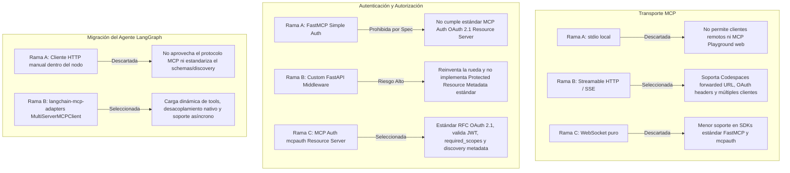
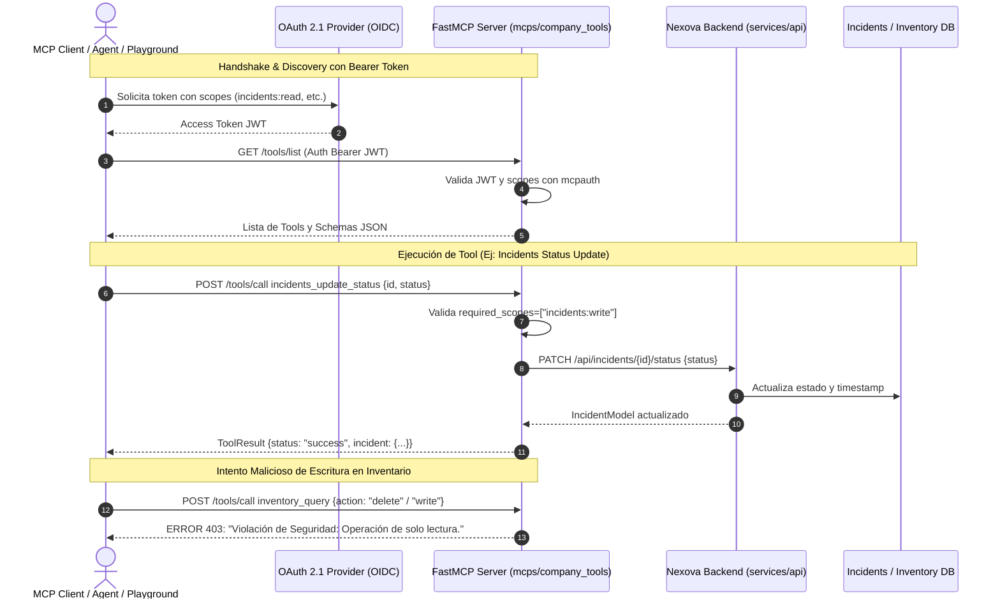

# Implementation Plan: Servidor MCP con OAuth 2.1 y Migración del Agente LangGraph

**Documento:** `.github/implementation-plan.md`  
**Copia de Respaldo:** `docs/plans/mcp-oauth-tools-plan.md`  
**Rama de Trabajo:** `feature/mcp-oauth-tools`  
**Nivel de Complejidad:** Nivel 3 — Arquitectura / Módulo Crítico  
**Framework de Calidad:** `skills/code-refinement-suite/SKILL.md`  

---

## 🧭 Resumen Ejecutivo y Objetivos

El presente plan establece la arquitectura, desarrollo, aseguramiento y migración para exponer las capacidades operativas de la compañía (Gestión de Incidentes y Consulta de Inventario) a través de un **Servidor MCP (Model Context Protocol)** independiente bajo el directorio `mcps/`. 

El servidor estará protegido mediante **OAuth 2.1 / OIDC** utilizando exclusivamente **`mcpauth`** (modo Resource Server con validación de JWT Bearer tokens, publicación de Protected Resource Metadata y control granular de *scopes*). 

Adicionalmente, se migrará el agente de soporte LangGraph (`services/agent/`) para que consuma estas capacidades a través de **`langchain-mcp-adapters`**, eliminando el acoplamiento directo previo con la base de datos o APIs internas sin romper el enrutamiento autónomo existente entre RAG y Tools.

---

## 📐 PACK 1: ARCHITECT (Ideación y Decisión Técnica)

### 1.1 Árbol de Pensamiento (Tree of Thoughts - ToT)

Evaluamos tres dimensiones críticas de diseño para determinar la mejor solución arquitectónica:



#### Justificación de Decisiones ToT:
1. **Transporte (`Streamable HTTP / SSE`):** El servidor debe poder ser consumido de forma remota por herramientas de inspección (como **MCP Playground** a través de la URL pública reenviada de GitHub Codespaces) y por servicios distribuidos. `stdio` confina la comunicación a pipes de procesos locales del sistema operativo, impidiendo la autenticación HTTP Bearer estándar y el acceso desde clientes externos o web.
2. **Autenticación (`mcpauth`):** El requerimiento del Tech Lead prohíbe explícitamente los helpers de autenticación integrados de FastMCP. Utilizar `mcpauth` permite configurar el servidor como un verdadero **OAuth 2.1 Resource Server**, exponiendo `/.well-known/oauth-protected-resource` y forzando `required_scopes` específicos para cada tool (`incidents:read`, `incidents:write`, `inventory:read`).
3. **Consumo en el Agente (`langchain-mcp-adapters`):** Convierte las tools descubiertas del servidor MCP en `BaseTool` de LangChain compatibles con el grafo de LangGraph, permitiendo reemplazar el nodo de tool directa sin alterar el grafo de control ni el enrutamiento inteligente RAG.

---

### 1.2 Análisis Multidisciplinar (3 Expertos)

#### 🎨 Experto en UX/UI y Experiencia de Agentes (Developer / Agent Experience)
- **Claridad del Discovery:** Los agentes LLM externos no disponen de contexto humano adicional. Las descripciones de las tools y los esquemas JSON de entrada/salida deben actuar como documentación auto-contenida (equivalente a un `--help` interactivo).
- **Consistencia en Respuestas de Error:** Cuando un cliente comete un error de validación o intenta una operación no permitida, el servidor debe responder con un mensaje descriptivo y estructurado que guíe al modelo (ej. *"Operación no permitida: el inventario es estrictamente de solo lectura"*).
- **Ergonomía en MCP Playground:** El endpoint HTTP SSE debe responder inmediatamente a los handshakes de inicialización (`initialize`, `tools/list`, `tools/call`).

#### 🏗️ Tech Lead / Arquitecto de Software
- **Separación de Responsabilidades:** El servidor MCP vivirá en `mcps/company_tools/` y no dentro de `services/`. El servidor actúa como una capa de presentación y orquestación estandarizada que se conecta a los servicios backend existentes (`services/api/routes/incidents.py` y `services/api/routes/inventory.py`), sin duplicar lógica de negocio ni alterar la base de datos de manera anárquica.
- **Transición Estricta de Estados en Incidentes:** Cualquier cambio de estado de incidentes DEBE invocar el endpoint especializado `PATCH /api/incidents/{id}/status` con validación de modelo (`IncidentUpdateStatus`), rechazando parches genéricos sobre la entidad.
- **Deprecación Limpia en el Agente:** En `services/agent/`, la función antigua `get_incident_ticket()` que accedía directamente a TinyDB quedará marcada como `@deprecated` y el nodo `incident_tool_node` pasará a consumir exclusivamente el cliente MCP.

#### 🛡️ Especialista en Ciberseguridad
- **OAuth 2.1 Resource Server:** Todo request sin cabecera `Authorization: Bearer <token>` válido debe ser rechazado inmediatamente con código HTTP 401 (`Unauthorized`).
- **Principio de Mínimo Privilegio (PoLP):** Implementación de `required_scopes` en cada tool. Por ejemplo, un token con scope `incidents:read` no podrá invocar `incidents_create` ni `incidents_update_status` (devolviendo 403 `Forbidden`).
- **Guardia Inviolable de Solo Lectura para Inventario:** La herramienta de inventario debe estar blindada a nivel de código y diseño. Si un cliente intenta invocar una mutación o pasar flags de modificación, el servidor lanzará una excepción explícita de violación de acceso (`PermissionDeniedError` / 403), auditando el intento.
- **Trazabilidad y Auditoría:** Cada invocación registrará un log estructurado con `timestamp`, `client_id` (del token JWT), `tool_name`, `parameters` (sanitizados) y `status` (SUCCESS / ERROR / FORBIDDEN).

---

## 📝 PACK 2: PLANNER (Estructuración y Refinamiento del Plan)

### 2.1 Abstracción de Alto Nivel (Step-Back Architecture)



---

### 2.2 Ciclos de Auto-Refinamiento (Self-Refinement Loop - 3 Ciclos)

- **Ciclo 1: ¿Cómo garantizamos la compatibilidad con MCP Playground desde GitHub Codespaces?**
  - *Refinamiento:* MCP Playground corre en el navegador del usuario y no puede alcanzar `localhost:8000` del contenedor remoto. Configuraremos el servidor MCP para escuchar en `0.0.0.0:8001` con transporte Streamable HTTP (SSE) y documentaremos el reenvío de puerto con visibilidad pública en Codespaces, configurando CORS permisivo para permitir el handshake desde el origen del Playground.
- **Ciclo 2: ¿Cómo evitamos conflictos entre las dependencias y la estructura de ramas del monorepo?**
  - *Refinamiento:* La rama actual `feature/mcp-oauth-tools` parte de `main`, pero los módulos del agente (`services/agent/`) fueron desarrollados en el hito anterior (`feature/langgraph-external-tools`, PR #29 pendiente de revisión). Incorporaremos ordenadamente los archivos de `services/agent/` mediante merge limpio o cherry-pick desde `feature/langgraph-external-tools` para que la migración del cliente LangGraph cuente con la base completa sin alterar los PRs abiertos #27, #28 y #29.
- **Ciclo 3: ¿Qué pasa si el servidor OAuth externo no está disponible durante pruebas locales?**
  - *Refinamiento:* Se configurará `mcpauth` para validar contra el emisor OIDC configurado en `.env`, y para desarrollo/testing unitario se creará un fixture con un mock local de JWKS / token generator para que los tests automatizados (`pytest`) se ejecuten de forma determinista y reproducible sin depender de red externa.

---

## 🗺️ Mapa de Trabajo por Fases (Roadmap)

### Fase 1: Configuración de Dependencias y Estructura de Proyecto
- [ ] Incorporar los archivos del agente LangGraph desde `feature/langgraph-external-tools` a la rama `feature/mcp-oauth-tools`.
- [ ] Instalar dependencias oficiales usando `uv add`:
  - `uv add fastmcp mcpauth langchain-mcp-adapters`
  - Verificar que `pyproject.toml` y `uv.lock` queden actualizados sin usar `pip`.
- [ ] Crear el árbol de directorios para servidores MCP bajo `mcps/`:
  - `mcps/__init__.py`
  - `mcps/company_tools/__init__.py`
  - `mcps/company_tools/server.py`
  - `mcps/company_tools/auth.py`
  - `mcps/company_tools/tools_incidents.py`
  - `mcps/company_tools/tools_inventory.py`
  - `mcps/company_tools/config.py`

### Fase 2: Implementación de la Capa de Seguridad OAuth 2.1 (`mcpauth`)
- [ ] Configurar `mcpauth.OAuthResourceServer` en `mcps/company_tools/auth.py`.
- [ ] Exponer los metadatos de recurso protegido (`Protected Resource Metadata` según OAuth 2.1 / OIDC).
- [ ] Configurar los scopes obligatorios:
  - `incidents:read`: Lectura y consulta de incidentes.
  - `incidents:write`: Creación y actualización de estado de incidentes.
  - `inventory:read`: Consulta exclusiva de inventario.
- [ ] Implementar middleware o decoradores para rechazar requests no autenticados (HTTP 401) y requests con scopes insuficientes (HTTP 403).
- [ ] Definir el sistema de logging de auditoría para registrar cada intento de invocación (cliente, tool, parámetros, resultado).

### Fase 3: Desarrollo de Herramientas del Negocio (FastMCP Tools)
- [ ] Crear la instancia de `FastMCP` con soporte de transporte **Streamable HTTP (SSE)** escuchando en `0.0.0.0:8001`.
- [ ] Implementar Tool 1: `incidents_get_status` (consulta de ticket por ID o coincidencia contra el backend existente).
- [ ] Implementar Tool 2: `incidents_create` (creación de nuevo ticket con validación de categorías y campos del backend).
- [ ] Implementar Tool 3: `incidents_update_status` (transición de ciclo de vida llamando específicamente a `PATCH /api/incidents/{id}/status`).
- [ ] Implementar Tool 4: `inventory_query_stock` (consulta de productos, existencias y almacén).
- [ ] Implementar **Guardia Estricta de Solo Lectura** en `tools_inventory.py`:
  - Detección y rechazo proactivo de cualquier parámetro o payload de mutación (`write`, `update`, `delete`, `stock_delta`).
  - Emisión de excepción explícita `PermissionDeniedError` con código y mensaje unificado.
- [ ] Enriquecer el *Discovery* de cada tool con docstrings exhaustivos, descripciones de parámetros y tipos Pydantic claros para LLMs externos.

### Fase 4: Validación y Verificación en MCP Playground
- [ ] Iniciar el servidor backend (`uv run uvicorn services.api.main:app --port 8000`).
- [ ] Iniciar el servidor MCP (`uv run python -m mcps.company_tools.server`).
- [ ] Exponer el puerto `8001` de GitHub Codespaces con visibilidad pública (`Port Forwarding -> Port 8001 -> Port Visibility: Public`).
- [ ] Obtener la URL pública reenviada de Codespaces (`https://<codespace-id>-8001.app.github.dev/sse`).
- [ ] Conectar desde **MCP Playground** utilizando dicha URL pública.
- [ ] Ejecutar flujo completo de prueba en Playground:
  - Handshake y listado de herramientas (`tools/list`).
  - Creación de ticket de incidencia (`incidents_create`).
  - Actualización de estado del ticket (`incidents_update_status`).
  - Consulta de stock de inventario (`inventory_query_stock`).
  - Intento de escritura en inventario (verificar que el servidor responde con error controlado 403).
- [ ] Capturar evidencias de ejecución y registrar logs de auditoría generados.

### Fase 5: Migración del Agente LangGraph (`langchain-mcp-adapters`)
- [ ] Actualizar el cliente del agente en `services/agent/` para conectarse al Servidor MCP mediante `MultiServerMCPClient` o `load_mcp_tools`.
- [ ] En `services/agent/nodes.py`:
  - Reemplazar el cuerpo de `incident_tool_node` para que despache la invocación hacia el cliente MCP en lugar de llamar directamente a `get_incident_ticket()`.
  - Asegurar manejo defensivo de errores y timeouts de red hacia el servidor MCP (activando la ruta de fallback existente ante fallos).
- [ ] En `services/agent/tools.py`:
  - Marcar `get_incident_ticket()` como `@deprecated` o retirarla de la ruta activa para asegurar que no existan dos caminos hacia el Incidents Manager.
- [ ] Validar que el nodo de enrutamiento autónomo (`classify_intent_node`) siga bifurcando correctamente entre `rag` y `incident_tool`.

### Fase 6: Suite de Pruebas Automatizadas y Red Teaming
- [ ] Crear suite de tests unitarios e integrados en `tests/test_mcp_server.py`:
  - Test de autenticación: verificación de rechazo 401 sin token.
  - Test de autorización: verificación de rechazo 403 con scope inválido.
  - Test de tools de incidentes: consulta, creación y `PATCH /api/incidents/{id}/status`.
  - Test de inventario: consulta exitosa y rechazo explícito ante payload de escritura.
  - Test de discovery: inspección de esquemas generados.
- [ ] Crear tests de regresión para el agente en `tests/pipelines/test_agent_mcp_integration.py`:
  - Verificar que el flujo del grafo ejecuta el nodo MCP sin romper los contratos de respuesta esperados.
- [ ] Ejecutar suite completa con `uv run pytest tests/`.

---

## 💻 PACK 3: CODER (Especificación Técnica de Componentes)

### 3.1 Contrato del Servidor MCP (`mcps/company_tools/server.py`)

```python
"""
Servidor MCP independiente para herramientas corporativas de Nexova Solutions.
Expone endpoints de gestión de incidentes y consulta de inventario vía Streamable HTTP.
"""
from fastmcp import FastMCP
from mcps.company_tools.config import settings
from mcps.company_tools.auth import configure_mcp_auth

mcp = FastMCP(
    name="Nexova Company Tools MCP Server",
    description="Servidor oficial de herramientas operativas de Nexova Solutions.",
    version="1.0.0",
)

# Configuración de OAuth 2.1 Resource Server con mcpauth
configure_mcp_auth(mcp)
```

### 3.2 Contrato de la Tool de Incidentes (Transición de Estado)

```python
@mcp.tool(
    name="incidents_update_status",
    description=(
        "Actualiza el estado en el ciclo de vida de una incidencia existente en Nexova Solutions. "
        "Utiliza obligatoriamente el endpoint de transición de estado PATCH /api/incidents/{id}/status. "
        "Estados permitidos: 'open', 'in_progress', 'resolved', 'closed'."
    ),
)
async def incidents_update_status(ticket_id: str, new_status: str) -> dict:
    ...
```

### 3.3 Contrato de la Tool de Inventario con Guardia de Solo Lectura

```python
@mcp.tool(
    name="inventory_query_stock",
    description=(
        "Consulta el catálogo y niveles de stock de productos e inventario de Nexova Solutions. "
        "Operación estrictamente de SOLO LECTURA. Cualquier intento de modificación será rechazado."
    ),
)
async def inventory_query_stock(product_id: str | None = None, category: str | None = None, **kwargs) -> dict:
    if kwargs.get("operation") in ["write", "update", "delete"] or "quantity" in kwargs:
        raise PermissionDeniedError("Operación de escritura no permitida: el inventario es de solo lectura por diseño.")
    ...
```

---

## 🛡️ PACK 4: AUDITOR (Seguridad, Red Teaming y Protocolo Git)

### 4.1 Escenarios de Ataque y Resiliencia (Red Teaming)

| Vector de Ataque / Caso Límite | Comportamiento Esperado | Verificación |
| :--- | :--- | :--- |
| **Ataque 1: Solicitud sin cabecera Bearer** | Rechazo inmediato con HTTP 401 Unauthorized | Test unitario con cliente anónimo |
| **Ataque 2: Token con scope insuficiente** | Rechazo con HTTP 403 Forbidden y detalle del scope faltante | Invocación con scope `inventory:read` hacia `incidents_create` |
| **Ataque 3: Inyección de mutación en Inventario** | Rechazo con 403 / ToolError explícito y log de seguridad | Invocación pasando parámetros de escritura |
| **Ataque 4: Transición de estado inválida** | Validación de esquema devuelve HTTP 422 / Error descriptivo | Intento de asignar estado no reconocido en Incidents Manager |
| **Ataque 5: Caída de la API backend** | Servidor MCP devuelve error controlado sin caerse ni fugar stack traces | Simulación de desconexión del backend |

---

### 4.2 Regla Inviolable de Control de Git

> [!CAUTION]
> **RECORDATORIO OBLIGATORIO:** Queda estrictamente prohibido ejecutar `git push` de forma autónoma. Al finalizar todas las fases de implementación y testing, se solicitará consentimiento explícito al usuario en chat.

---

## ⚙️ Métodos Aplicados (Code Refinement Suite)

Para dar cumplimiento formal al estándar de excelencia metodológica exigido por la suite:

1. **Tree of Thoughts (ToT):** Se evaluaron formalmente en el Pack 1 tres alternativas de transporte (stdio, SSE, WebSockets), tres alternativas de autenticación (FastMCP auth, Custom Middleware, `mcpauth`) y dos estrategias de migración de clientes para el agente LangGraph.
2. **Step-Back Prompting:** Se abstrajo la interacción en un modelo de capas desacopladas (Cliente -> OAuth Resource Server -> Servidor MCP -> APIs de Negocio -> TinyDB/SQLite), asegurando que el servidor MCP funcione como fachada agnóstica para cualquier agente externo.
3. **Self-Refinement Loop (3 Ciclos):** Se llevaron a cabo 3 iteraciones de crítica constructiva resolviendo la accesibilidad pública en Codespaces, la compatibilidad con las ramas de Git del monorepo y la resiliencia en pruebas unitarias mediante mocks de OIDC.
4. **Principio de Mínimo Privilegio y Red Teaming:** Se definieron matrices de scopes granulares y 5 escenarios de prueba de penetración defensiva para verificar la inviolabilidad de la herramienta de inventario y la autenticación.
5. **Chain of Verification (CoVe) & TDD:** Toda la implementación de código y schemas se contrastará paso a paso contra los contratos existentes en `services/api/routes/incidents.py` y `services/api/routes/inventory.py`, validándose con `uv run pytest`.

