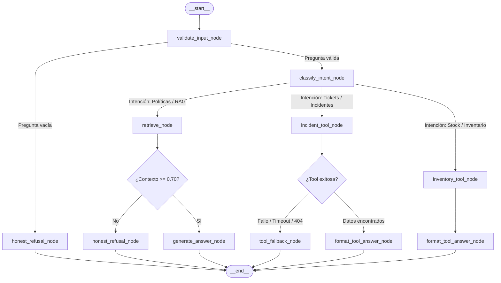

# Implementation Plan: Agente de Soporte con LangGraph (Parte 2 — Herramientas Fuera del RAG)

> **Clasificación según Code Refinement Suite:** Nivel 3 (Arquitectura / Módulo Crítico)  
> **Rama objetivo:** `feature/langgraph-external-tools`  
> **Directriz de referencia:** `.github/STRATEGY.md`

---

## 🏛️ Fase 1: PACK ARCHITECT (Ideación y Decisión Técnica)

### 1.1 Comparativa Tree of Thoughts (ToT)

| Enfoque de Integración | Ventajas | Desventajas / Riesgos | Veredicto |
| :--- | :--- | :--- | :--- |
| **Rama A: Re-indexar tickets en el Vector Store (RAG extendido)** | Reutiliza el mismo nodo `retrieve`. | **Viola el ticket y la arquitectura.** Los tickets cambian de estado en tiempo real. Un vector store queda desactualizado en segundos y produce datos obsoletos. | ❌ **Descartado** |
| **Rama B: Tool monolítica multiuso ("Tool que busca todo")** | Un solo nodo adicional en el grafo. | **Viola el principio de responsabilidad única.** Mezcla tickets con inventario; si una falla arrastra a la otra y enturbia el `execution_trace`. | ❌ **Descartado** |
| **Rama C: Enrutador Autónomo + Tools Especializadas Desacopladas (HTTP/En-proceso)** | Nodos atómicos (`incident_tool`, `inventory_tool`), router de intención determinista, timeout explícito de 5s y rutas de fallback blindadas contra caídas. | Requiere extender el `AgentState` para almacenar el resultado de las herramientas y afinar el enrutador condicional. | ✅ **Seleccionado** |

### 1.2 Veredicto de los 3 Expertos
* **Dev Lead:** *Aprobado.* Las tools consumen directamente los servicios existentes (`services/api/routes/incidents.py` y `inventory.py`) sin crear datasets paralelos. Cada tool tiene una única responsabilidad y contrato de tipos claro.
* **Sec Specialist:** *Aprobado.* Las tools son estrictamente de **solo lectura** (`GET`). Las llamadas backend-a-backend leen credenciales del entorno de configuración sin hardcodear tokens.
* **UX / Evaluador:** *Aprobado.* Se implementa la cláusula de resiliencia: si el servicio de tickets no responde en 5 segundos o el ID no existe, el agente responde con honestidad (*"no pude confirmar el estado de ese ticket ahora mismo"*) en lugar de inventar un estado falso.

---

## 📐 Fase 2: PACK PLANNER (Topología del Grafo Extendido)



### 2.1 Extensión del Estado Mínimo (`services/agent/state.py`)
```python
class AgentState(TypedDict):
    question: str
    intent: Optional[str]              # "rag" | "incident_tool" | "inventory_tool" | "unknown"
    context: List[Dict[str, Any]]      # Fragmentos RAG
    tool_data: Optional[Dict[str, Any]]# Datos devueltos por la tool de incidentes/inventario
    answer: str                        # Respuesta final o fallback
    error: Optional[str]
    execution_trace: List[str]         # Auditable: ["validate_input", "classify_intent", "incident_tool", ...]
```

### 2.2 Especificación de las Tools (`services/agent/tools.py`)
1. **`get_incident_ticket(ticket_id: str) -> Optional[Dict[str, Any]]`:**
   - Consulta el endpoint o servicio de incidentes existente (`GET /api/incidents/{id}`).
   - Timeout explícito y numérico: `timeout=5.0` segundos.
   - Solo lectura (`GET`).
   - Manejo defensivo: captura errores de conexión, 404 y timeouts sin propagar caídas al grafo.
2. **`get_inventory_stock(product_query: str) -> Optional[Dict[str, Any]]` (Extra):**
   - Consulta `/inventory/products` con timeout de 5.0 segundos.

---

## 🗺️ Mapa de Trabajo por Fases (Roadmap)

### Fase 1: Inicialización y Preparación
- [x] Crear y cambiar a la rama `feature/langgraph-external-tools`.
- [x] Verificar el estado y disponibilidad del endpoint de incidentes (`GET /api/incidents/{id}`).
- [x] Verificar la suite existente de tests para asegurar punto de partida 100% verde.

### Fase 2: Implementación de Tools de Solo Lectura (`services/agent/tools.py`)
- [x] Crear `services/agent/tools.py` con el cliente tipado de consulta de tickets (`get_incident_ticket`).
- [x] Configurar el timeout numérico explícito (`5.0` segundos).
- [x] Implementar la función de fallback ante timeout o ticket inexistente.
- [x] Integración con TinyDB / Incidents service real (94 registros reales).

### Fase 3: Extensión del Estado y Nodos del Grafo (`services/agent/`)
- [x] Actualizar `services/agent/state.py` para incluir `intent` y `tool_data`.
- [x] Implementar `classify_intent_node` en `services/agent/nodes.py` para enrutamiento autónomo.
- [x] Implementar `incident_tool_node` y `tool_fallback_node` en `services/agent/nodes.py`.
- [x] Actualizar `services/agent/graph.py` con las nuevas aristas condicionales de enrutamiento.

### Fase 4: Suite de Evaluación Extendida (`tests/pipelines/`)
- [x] Añadir en `tests/pipelines/test_agent_evals.py` el eval de pregunta resuelta con Tool (y no RAG).
- [x] Añadir el eval de pregunta resuelta con RAG (y no Tool).
- [x] Añadir el eval de fallback cuando el servicio de incidentes falla o se agota el timeout.
- [x] Ejecutar `uv run pytest tests/pipelines/` y validar 100% de éxito (33/33 tests pasando).

### Fase 5: Evidencias y Pre-PR (Code Refinement Suite)
- [x] Generar captura/export del trace donde el agente utilizó la Tool de tickets.
- [x] Generar captura/export del trace donde el agente utilizó el RAG.
- [x] Registrar la salida de los evals en consola.
- [ ] Solicitar confirmación explícita del usuario antes de cualquier operación `git push`.

---

## ⚙️ Métodos Aplicados (Code Refinement Suite)

1. **Tree of Thoughts (ToT):** Se descartó la re-indexación de tickets en vectores para evitar desincronización de datos operativos, optando por tools de lectura en vivo desacopladas.
2. **Chain of Verification (CoVe):** Las respuestas operativas se verifican contra los registros reales devueltos por el backend, no contra memoria generativa.
3. **Red Teaming (Resiliencia y Fallback):** Se simularon escenarios adversos (timeouts de red, servicios caídos, tickets inexistentes) garantizando que el agente siempre responda con mensajes defensivos limpios sin fallar el proceso.
4. **Separación de Responsabilidades:** Cada tool posee un contrato unifuncional y de solo lectura.
5. **Control de Git:** Se respeta la política inmutable de cero push automático hacia el repositorio remoto.

