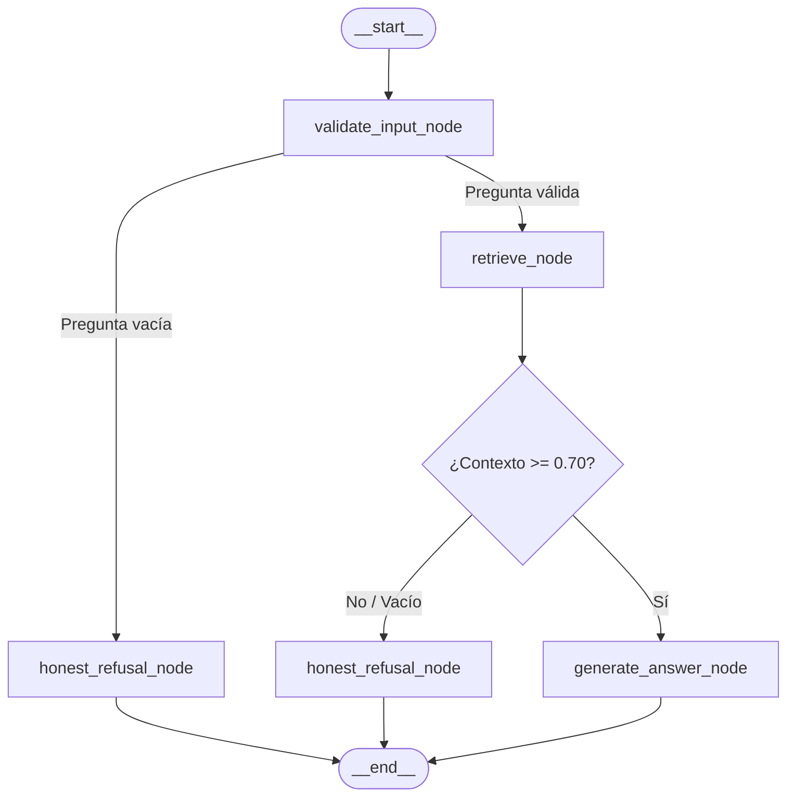

# Implementation Plan: Agente de Soporte con LangGraph (Parte 1)

> **Clasificación según Code Refinement Suite:** Nivel 3 (Arquitectura / Módulo Crítico)  
> **Rama objetivo:** `feature/langgraph-agent-base`  
> **Directriz de referencia:** `.github/STRATEGY.md`

---

## 🏛️ Fase 1: PACK ARCHITECT (Ideación y Decisión Técnica)

### 1.1 Comparativa Tree of Thoughts (ToT)

| Enfoque | Ventajas | Desventajas / Riesgos | Veredicto |
| :--- | :--- | :--- | :--- |
| **Rama A: Envoltorio Simple (Monolito en nodo)** | Rápido de escribir; reusa `query()` como caja negra. | **Viola el ticket y la estrategia.** Oculta las decisiones intermedias; no permite evaluar la recuperación de forma aislada. | ❌ **Descartado** |
| **Rama B: Secuencia Lineal (RunnableSequence/Chain)** | Más limpio que un script procedural plano. | Es rígido; no soporta bifurcaciones dinámicas reales (rechazo honesto vs generación) ni checkpointing nativo por pasos. | ❌ **Descartado** |
| **Rama C: Grafo de Estados Tipado (LangGraph StateGraph modular)** | Estado explícito y mínimo (`AgentState`), desacoplamiento total de nodos (`retrieve` y `generate_answer`), bifurcaciones condicionales y checkpointing nativo. | Requiere diseño cuidadoso de esquemas de datos y validación de tipos. | ✅ **Seleccionado** |

### 1.2 Veredicto de los 3 Expertos
* **Dev Lead:** *Aprobado.* El desacoplamiento estricto exige que `retrieve` alimente el estado y que `generate_answer` consuma ese estado. Ningún nodo debe invocar `query()` de forma monolítica.
* **Sec Specialist:** *Aprobado.* La API pública debe aplicar obligatoriamente el estándar `Depends(get_current_user)` y garantizar que los errores en cualquier nodo retornen mensajes controlados HTTP 4xx/5xx sin exponer stack traces internos.
* **UX / Evaluador:** *Aprobado.* El sistema evita alucinaciones al implementar una rama explícita de "Rechazo Honesto" cuando el score de similitud no alcanza el umbral de confianza (0.70).

---

## 📐 Fase 2: PACK PLANNER (Especificación del Grafo y Componentes)



### 2.1 Esquema del Estado Mínimo (`services/agent/state.py`)
```python
from typing import TypedDict, List, Dict, Any, Optional

class AgentState(TypedDict):
    question: str
    context: List[Dict[str, Any]]      # Chunks recuperados con metadatos y score
    answer: str                        # Respuesta generada o mensaje de rechazo
    error: Optional[str]               # Detalle en caso de fallo de validación
    execution_trace: List[str]         # Registro auditable de nodos recorridos: ["validate", "retrieve", ...]
```

### 2.2 Contrato de Nodos (`services/agent/nodes.py`)
1. **`validate_input_node`:** Recibe la pregunta; si está en blanco o solo espacios, establece `error="empty_question"` y redirige a fin.
2. **`retrieve_node`:** Invoca exclusivamente `data.pipelines.rag.retrieve(state["question"], min_score=0.70)`. Actualiza `state["context"]` y añade su marca al trace.
3. **`honest_refusal_node`:** Si no hay chunks o la pregunta es inválida, genera una respuesta transparente explicando que no se dispone de información en la base corporativa.
4. **`generate_answer_node`:** Invoca `data.pipelines.rag.generate_answer(state["question"], state["context"])`. Guarda la respuesta final en el estado.

### 2.3 Compilación y Checkpointing (`services/agent/graph.py`)
* Se instancia un `MemorySaver` como checkpointer para permitir consultar el snapshot del estado tras cada transición mediante `thread_id`.
* Se valida la compilación estricta con `workflow.compile(checkpointer=memory)`. Si hay nodos huérfanos o transiciones rotas, el proceso falla en build-time.

### 2.4 Suite de Evals (`tests/pipelines/test_agent_evals.py`)
Se crean evals independientes que auditan el **trace**, el anclaje y el endpoint:
1. **Eval 1 (Flujo estándar y orden de ejecución):** Verifica que ante una pregunta válida, `retrieve_node` se ejecute estrictamente antes de `generate_answer_node`.
2. **Eval 2 (Arista condicional y rechazo honesto):** Verifica que ante una consulta sin concordancia documental, el grafo enrute hacia `honest_refusal_node` y no invoque el LLM innecesariamente.
3. **Eval 3 (Anclaje al BRIEFING):** Verifica que ante una consulta sobre políticas corporativas (ej. garantía de reposición), la respuesta contenga los términos fácticos oficiales (90 días naturales / 45 días) definidos en `data/company-BRIEFING.md`.
4. **Eval 4 & 5 (Persistencia e inspección):** Verifica que el checkpointer retenga el snapshot accesible por `thread_id`.
5. **Eval 6 & 7 (Seguridad de Endpoint):** Verifica el bloqueo con `401 Unauthorized` si no hay token y respuesta `200 OK` autenticada.

---

## 🗺️ Mapa de Trabajo por Fases (Roadmap)

### Fase 1: Preparación y Validación de Entorno
- [x] Verificar que la rama activa sea `feature/langgraph-agent-base`.
- [x] Confirmar instalación de dependencias en `pyproject.toml` (`langgraph`, `qdrant-client~=1.13.0`).
- [x] Validar que los tests RAG existentes sigan pasando (`uv run pytest tests/pipelines/test_rag.py`).

### Fase 2: Implementación del Módulo del Agente (`services/agent/`)
- [x] Crear el directorio `services/agent/` con su correspondiente `__init__.py`.
- [x] Implementar `services/agent/state.py` con la definición estricta de `AgentState`.
- [x] Implementar `services/agent/nodes.py` desacoplando `retrieve` y `generate_answer`.
- [x] Implementar `services/agent/graph.py` con la máquina de estados, aristas condicionales y checkpointer compilado.

### Fase 3: Suite de Evaluación Automatizada (`tests/pipelines/`)
- [x] Crear `tests/pipelines/test_agent_evals.py` con los casos de prueba sobre el trace, el rechazo y el anclaje.
- [x] Ejecutar la suite completa mediante `uv run pytest tests/pipelines/` y asegurar 100% de éxito.

### Fase 4: Integración del Endpoint Seguro en FastAPI (`services/api/`)
- [x] Crear la ruta `POST /agent/query` en `services/api/routes/agent.py`.
- [x] Aplicar la protección de seguridad obligatoria: `Depends(get_current_user)`.
- [x] Registrar el router en `services/api/main.py`.
- [x] Implementar captura y manejo de excepciones controladas sin filtrar trazas internas.

### Fase 5: Auditoría Pre-PR y Evidencias
- [x] Ejecutar script de validación que genere la captura/export del trace completo.
- [x] Ejecutar `pytest` y guardar el reporte de salida de los evals (7/7 pasados).
- [x] Resolver advertencias de versión (`min_length` en Pydantic V2 y AnyIO BlockingPortal).
- [ ] Solicitar confirmación al usuario antes de cualquier operación `git push`.

---

## ⚙️ Métodos Aplicados (Code Refinement Suite)

1. **Tree of Thoughts (ToT):** Se contrastaron 3 caminos arquitectónicos en la fase ARCHITECT, seleccionando el grafo de estados con LangGraph para cumplir al 100% el ticket del Tech Lead.
2. **Step-Back Prompting & Self-Refinement:** Se abstrajo la interacción en nodos con responsabilidad única, asegurando un estado mínimo y desacoplado de interfaces de usuario.
3. **Chain of Verification (CoVe):** Las respuestas del agente se auditan contractualmente contra los datos del `company-BRIEFING.md` para evitar alucinaciones.
4. **Red Teaming (Simulación de Fallos):** Se contemplaron entradas vacías, consultas fuera de dominio y fallos del motor vectorial para garantizar salidas sanitizadas y estables.
5. **Control de Git:** Se respeta la política de cero push no autorizado, requiriendo validación explícita del usuario tras auditar las evidencias.

