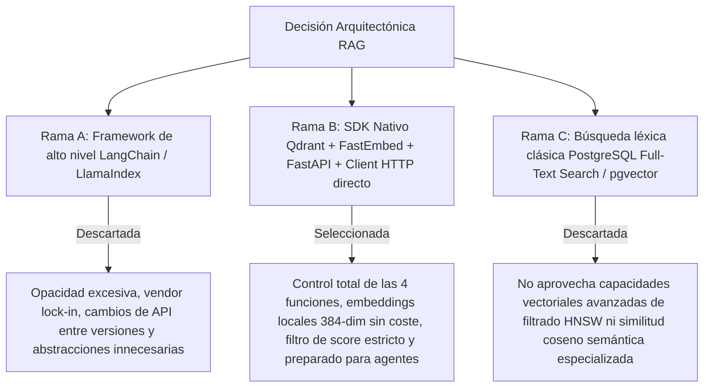

# Implementation Plan: Sistema RAG y Base de Conocimiento con Qdrant y FastAPI (Nexova Solutions)

> **Documento de Arquitectura y Planificación de Producción**  
> **Basado en:** `.github/STRATEGY.md`, `.github/RAG-ARCHITECTURE.md`, `skills/qdrant-rag-builder/SKILL.md`, `nexova-BRIEFING.md`  
> **Marco Metodológico:** Code Refinement Suite (Nivel 3 — Arquitectura Crítica de Sistemas RAG & Búsqueda Vectorial)  
> **Modalidad:** Modo Tutor / Aprendizaje guiado (el mentor acompaña, el usuario ejecuta paso a paso)  

---

## 📌 Contexto y Objetivos del Hito

En Nexova Solutions, el equipo comercial y operativo (headhunting, outsourcing de soporte y formación corporativa) pierde tiempo valioso localizando políticas internas, acuerdos de nivel de servicio (SLAs) y catálogos de servicios dispersos. 

El objetivo de este hito es desplegar un **asistente RAG (Retrieval-Augmented Generation) 100% modular, privado y desacoplado**, que permita a los consultores y ejecutivos realizar consultas en lenguaje natural y obtener respuestas precisas fundamentadas exclusivamente en la documentación oficial de Nexova (`docs/company-knowledge-base/`), sin alucinaciones y sin frameworks de orquestación de alto nivel (cero LangChain y cero LlamaIndex).

---

## 🏛️ PACK 1: ARCHITECT — Evaluación de Alternativas Técnicas (Tree of Thoughts)

Se evaluaron tres arquitecturas para la implementación de la base de conocimiento vectorial:

### Veredicto de los 3 Expertos:
- **Dev Lead:** La modularización en 4 funciones elementales (`setup`, `embed`, `retrieve`, `query`) desacopla la preparación de datos del consumo. Factorizar `generate_answer(question, context)` garantiza que futuros agentes (LangGraph) reutilicen la recuperación y generación de forma independiente.
- **AI & Security Specialist:** El uso de `FastEmbed` (`BAAI/bge-small-en-v1.5`) garantiza que los embeddings corran en local vía ONNX sin enviar datos confidenciales fuera del servidor. El umbral estricto `min_score` en `retrieve()` evita inyectar ruido o forzar alucinaciones en el prompt.
- **Operations & Product Lead:** Exponer la funcionalidad mediante un endpoint REST (`POST /knowledge/query`) protegido con `Auth Guard Standard` permite integrarlo de forma transparente con el dashboard corporativo en Next.js.

---

## 🗺️ Mapa de Trabajo por Fases (Roadmap)

### Fase 0: Rama Git, Infraestructura Docker y Dependencias
- [x] **Paso 0.1 — Creación de Rama de Trabajo:**
  - Crear y conmutar a la rama `feature/rag-knowledge-base`.
- [x] **Paso 0.2 — Infraestructura Qdrant en Docker:**
  - Añadir servicio `qdrant` en `docker-compose.yml` (imagen `qdrant/qdrant:v1.12.0`, puerto `6333:6333`, volumen `qdrant_data`).
  - Levantar el contenedor y verificar conectividad REST vía `curl http://localhost:6333/readyz`.
- [x] **Paso 0.3 — Dependencias con UV:**
  - Instalar dependencias mediante `uv add qdrant-client fastembed httpx`.
- [x] **Paso 0.4 — Corpus de Conocimiento de Nexova:**
  - Crear carpeta `docs/company-knowledge-base/` e incorporar los documentos fuente de la empresa (políticas de contratación, catálogo de servicios de outsourcing, formación corporativa y SLAs).

---

### Fase 1: Ingesta, Chunking Semántico e Indexación (`data/process/rag.py`)
- [x] **Paso 1.1 — Función de Vectorización (`embed`):**
  - Implementar `embed(text: str) -> list[float]` utilizando `fastembed` (`BAAI/bge-small-en-v1.5`, dimensión 384).
- [x] **Paso 1.2 — Parser y Chunking Semántico:**
  - Implementar partición de documentos por encabezados Markdown (`##`) para preservar unidades lógicas completas (políticas, garantías y condiciones intactas).
- [x] **Paso 1.3 — Ingesta e Idempotencia (`setup`):**
  - Implementar `setup()` en `data/process/rag.py` para recrear la colección `nexova_knowledge` en Qdrant e indexar los puntos con payload completo (`source_document`, `section`, `company`, `language`, `chunk_index`, `text`).
  - Ejecutar `setup()` y verificar conteo de puntos indexados.

---

### Fase 2: Pipeline de Recuperación y Generación (`data/pipelines/rag.py`)
- [x] **Paso 2.1 — Recuperación Semántica con Umbral (`retrieve`):**
  - Implementar `retrieve(query: str, *, k: int = 5, min_score: float = 0.70) -> list[dict]`.
  - Usar `client.query_points()` con `score_threshold=min_score` y devolver exclusivamente payloads limpios.
- [x] **Paso 2.2 — Generación Factorizada (`generate_answer`):**
  - Implementar `generate_answer(question: str, context: list[dict]) -> str` conectando al endpoint `/chat/completions`.
  - Inyectar en el System Prompt la voz corporativa de Nexova y la cláusula anti-alucinaciones (respuesta honesta cuando `context` esté vacío).
- [x] **Paso 2.3 — Orquestador Público (`query`):**
  - Implementar `query(question: str) -> str` componiendo `retrieve` y `generate_answer`.

---

### Fase 3: Endpoint REST en FastAPI (`services/api/routes/knowledge.py`)
- [x] **Paso 3.1 — Creación del Router:**
  - Crear `services/api/routes/knowledge.py` con schemas Pydantic `QueryRequest(question=...)` y `QueryResponse(answer=...)`.
  - Exponer `POST /knowledge/query` invocando `query()` desde `data.pipelines.rag`.
  - Proteger el endpoint con `Auth Guard Standard` (`Depends(get_current_user)`).
- [x] **Paso 3.2 — Registro en la Aplicación Principal:**
  - Registrar el router en `services/api/main.py`.

---

### Fase 4: Interfaz de Usuario de Consulta (`uis/`)
- [x] **Paso 4.1 — Página de Asistente RAG:**
  - Crear vista de consulta en Next.js (Backoffice o panel dedicado) con campo de texto, botón de envío y visualizador de respuesta formateada en Markdown.
- [x] **Paso 4.2 — Gestión de Estados:**
  - Manejar estados de carga (*spinner / skeleton*) y estados de error con mensajes informativos claros.

---

### Fase 5: Suite de Pruebas Unitarias y Benchmark de Evaluación
- [x] **Paso 5.1 — Tests Unitarios con Mocks (`tests/pipelines/test_rag.py`):**
  - Test 1: Filtrado estricto por `min_score` en `retrieve()`.
  - Test 2: Respuesta honesta de `generate_answer()` ante contexto vacío.
  - Test 3: Orquestación secuencial de `query()` (`retrieve` + `generate_answer`).
  - Ejecutar `uv run pytest tests/pipelines/test_rag.py -v` (7/7 passed).
- [x] **Paso 5.2 — Benchmark de Evaluación (`Recall@3`):**
  - Crear `data/eval/test-queries.json` con al menos 8 preguntas de control cubriendo todos los documentos del corpus.
  - Implementar y ejecutar script de evaluación que compruebe que $\text{Recall@3} \ge 80\%$ (100% alcanzado).

---

### Fase 6: Documentación Técnica de Diseño (`docs/rag/rag-design.md`) y Auditoría Git
- [x] **Paso 6.1 — Redacción de `docs/rag/rag-design.md`:**
  - Documentar proceso E2E, justificación de chunking semántico, configuración de embeddings y calibración del umbral `min_score`.
- [x] **Paso 6.2 — Checklist de Pre-Entrega:**
  - [x] Los 4 puntos de entrada (`setup`, `embed`, `retrieve`, `query`) modularizados.
  - [x] Qdrant corre en Docker y `setup()` es idempotente.
  - [x] Endpoint `POST /knowledge/query` protegido y funcional.
  - [x] Tests en `test_rag.py` pasando 100% en verde.
  - [x] Benchmark Recall@3 $\ge 80\%$.
- [ ] **Paso 6.3 — Protocolo de Control Git (PACK 4):**
  - Solicitar consentimiento explícito al usuario antes de cualquier `git push`.

---

## ⚙️ Métodos Aplicados (Code Refinement Suite)

1. **Tree of Thoughts (ToT - PACK 1: ARCHITECT):**  
   Se evaluaron alternativas de orquestación, descartando frameworks opacos como LangChain para garantizar control fino del SDK de Qdrant, compatibilidad local y trazabilidad de cada llamada matemática.
2. **Step-Back Prompting & Domain Abstraction (PACK 2: PLANNER):**  
   Se separó la recuperación semántica del razonamiento generativo: `retrieve()` se especializa en cálculo vectorial y filtrado por umbral, mientras `generate_answer()` se especializa en adherencia fáctica y voz de negocio.
3. **Chain of Verification (CoVe) & TDD (PACK 3: CODER):**  
   Se diseñan tests con mocks para validar el comportamiento del pipeline ante consultas fuera de dominio y contextos vacíos sin depender de servicios externos en CI.
4. **Red Teaming & Resilience Audit (PACK 4: AUDITOR):**  
   Se valida que la API nunca exponga fragmentos crudos de bases de datos vectoriales al cliente y que la aplicación responda con honestidad ante preguntas capciosas o fuera de conocimiento.