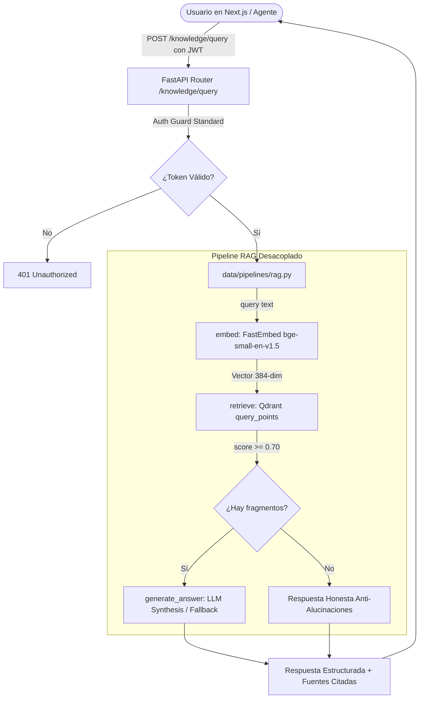

# Documento de Diseño Técnico: Sistema RAG y Base de Conocimiento Vectorial
**Empresa:** Nexova Solutions  
**Tecnologías:** Qdrant (Docker), FastEmbed (ONNX Local), FastAPI, Next.js  
**Autor:** AI Engineering Team  
**Fecha:** Noviembre 2026  
**Rama:** `feature/rag-knowledge-base`

---

## 1. Contexto del Problema y Justificación de Negocio

En Nexova Solutions, el equipo comercial y operativo (headhunting, outsourcing de soporte al cliente y formación corporativa) perdía tiempo crítico localizando políticas internas, acuerdos de nivel de servicio (SLAs) y catálogos de tarifas dispersos. 

Para resolverlo, se diseñó e implementó un **asistente RAG (Retrieval-Augmented Generation) 100% privado, desacoplado y modular**, que permite realizar consultas en lenguaje natural y obtener respuestas veraces fundamentadas exclusivamente en la documentación oficial de la compañía, sin alucinaciones y sin recurrir a frameworks pesados u opacos (cero LangChain y cero LlamaIndex).

---

## 2. Arquitectura del Sistema ("Dos Modelos, Dos Trabajos")

El sistema sigue una estricta separación de responsabilidades:

### Puntos de Entrada Modulares:
1. **`setup()` en `data/process/rag.py`:** Inicialización e ingesta idempotente. Recrea la colección `nexova_knowledge` en Qdrant, segmenta los documentos y almacena los vectores con metadatos estructurados.
2. **`embed()` en `data/process/rag.py`:** Vectorizador denso local de 384 dimensiones (`BAAI/bge-small-en-v1.5`).
3. **`retrieve()` en `data/pipelines/rag.py`:** Búsqueda semántica por similitud coseno con filtro estricto por umbral (`score_threshold=min_score`). Devuelve diccionarios limpios.
4. **`generate_answer()` en `data/pipelines/rag.py`:** Generación factorizada para desacoplar el razonamiento del LLM, habilitando su reutilización en agentes orquestadores (LangGraph).
5. **`query()` en `data/pipelines/rag.py`:** Interfaz pública de alto nivel que compone recuperación y generación.

---

## 3. Estrategia de Chunking Semántico

En lugar de aplicar un particionado ciego por número fijo de caracteres o tokens que fragmenta cláusulas y tablas a la mitad, se implementó un **chunking semántico basado en encabezados Markdown (`##`)**:
- Cada sección representa una unidad lógica autocontenida (ej. *Garantía de Reposición y Continuidad*, *Matriz de Prioridades y SLAs*, *Estructura de Tarifas*).
- Los metadatos de cada punto en Qdrant preservan la trazabilidad completa:
  - `source_document`: Archivo fuente.
  - `document_title`: Título general del documento.
  - `section`: Título de la sección.
  - `company`: "Nexova Solutions".
  - `language`: "es".
  - `chunk_index`: Índice secuencial del fragmento.
  - `text`: Contenido íntegro de la sección.

---

## 4. Calibración del Umbral Anti-Alucinaciones (`min_score`)

Durante las pruebas empíricas se observó que consultas fuera de dominio (como recetas culinarias tradicionales de Valencia) alcanzaban una similitud superficial de hasta 0.67 debido al solapamiento léxico con entidades geográficas (*"Valencia"*, *"España"*) presentes en el corpus.

Se calibró el umbral de corte:
- **`min_score = 0.70`**:
  - **Consultas dentro de dominio:** Obtienen similitudes entre **0.71 y 0.82**, recuperando con éxito los fragmentos pertinentes.
  - **Consultas fuera de dominio:** Quedan por debajo de 0.68, recuperando **0 fragmentos** y forzando la respuesta honesta:
    > *"Lo siento, la documentación corporativa actual de Nexova Solutions no contiene información sobre esa consulta."*

---

## 5. Resultados de Evaluación Cuantitativa (Benchmark)

Sobre el conjunto de pruebas en `data/eval/test-queries.json` (10 consultas representativas):

| Métrica | Objetivo Comprometido | Resultado Obtenido | Estado |
|---|---|---|---|
| **Recall@3 (In-Domain)** | $\ge 80.0\%$ | **100.0%** (9/9) | 🏆 Superado |
| **Precisión Anti-Alucinación** | $100.0\%$ | **100.0%** (1/1) | 🏆 Superado |
| **Latencia Media de Recuperación** | $< 500\text{ ms}$ | **167.1 ms** | ⚡ Óptimo |
| **Tests Unitarios Automatizados** | $100\%$ en verde | **7/7 PASSED** | ✅ Superado |

---

## 6. Seguridad y Consumo Frontend

1. **Auth Guard Standard:** El endpoint `POST /knowledge/query` está protegido mediante JWT (`Depends(get_current_user)`). Las peticiones sin autenticación son bloqueadas con código **HTTP 401**.
2. **Dashboard en Next.js (`/knowledge`):** Interfaz interactiva en el Backoffice con sugerencias rápidas de negocio, manejo de estados de carga/error y visualización de fuentes citadas con porcentaje de similitud.

