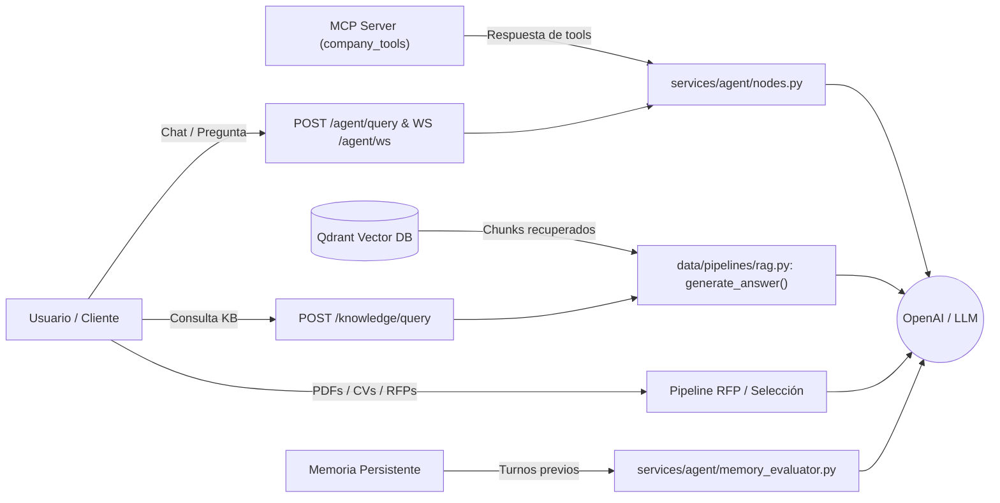

# Prácticas Seguras en la Integración de IA (NIST CSF 2.0) — Nexova Solutions

> **Objetivo:** Mapear toda la superficie donde un modelo de lenguaje (LLM) recibe input externo, mantener el inventario vivo de sistemas de IA bajo responsabilidad compartida, implementar controles *Security-by-Design* y documentar las 6 funciones NIST CSF 2.0 alineadas con **RGPD (AEPD 72h)**, **FIPA (30 días)**, **FCRA** y la **Ley de IA de la UE**.

---

## 1. Mapa de Puntos de Entrada Externos a los LLMs

| # | Punto de Entrada Externo | Origen del Texto | Archivo / Endpoint | Riesgo Principal | Control Actual / Objetivo |
| :-: | :--- | :--- | :--- | :--- | :--- |
| 1 | Chat de soporte (HTTP & WebSocket) | Usuario autenticado | `POST /agent/query`, `WS /agent/ws/{session_id}` (`services/api/routes/agent.py`) | Prompt Injection directa, agotamiento de tokens/costo | `check_input_security`, delimitación, **rate limit `429`** (Fase 2) |
| 2 | Consulta RAG corporativa | Usuario autenticado | `POST /knowledge/query` (`services/api/routes/knowledge.py`) | Fuga cross-tenant / rol, abuso de costo | Filtro `role`/`department`/`tenant_id` + **rate limit `429`** (Fase 2) |
| 3 | Chunks de Base de Conocimiento | Documentos en Qdrant (`nexova_knowledge`) | `data/pipelines/rag.py:retrieve()` → `generate_answer()` | Prompt Injection indirecta, envenenamiento RAG | `isolate_external_chunks`, `sanitize_external_text` |
| 4 | Salidas de herramientas MCP | TinyDB / Backend vía FastMCP | `services/agent/tools.py` ← `mcps/company_tools/tools_incidents.py` | Prompt Injection indirecta en títulos/descripciones, IDOR | `check_tenant_access` + sanitización + **`action_gate`** (Fase 2) |
| 5 | Evaluador de memoria persistente | Mensajes de usuario + contexto previo | `services/agent/memory_evaluator.py:143-233` | Envenenamiento de memoria a largo plazo | Propuesta HITL *default-deny* |
| 6 | Ingesta de documentos (RFPs / CVs) | PDFs y formularios externos | `data/pipelines/rfp_intake/nodes.py:92-186` | Instrucciones ocultas en CVs/RFPs | Delimitación + HITL antes de aprobar/descartar |

---

## 2. Revisión de `.env.example` y Manejo de Credenciales

Revisión ejecutada sobre `.env.example` y `quick_security_scan.sh`:
- **Secretos hardcoded en código:** `0` coincidencias (`services/api/security.py` y `mcps/company_tools/config.py` fallan cerrado si falta `SECRET_KEY` o `MCP_JWT_SECRET`).
- **Brecha detectada en `.env.example`:** No documenta de forma explícita las variables de proveedor de IA y vector DB (`OPENAI_API_KEY`, `LLM_API_KEY`, `LLM_MODEL`, `QDRANT_URL`) que consumen `data/pipelines/rag.py`, `services/agent/memory_evaluator.py` y `data/pipelines/rfp_intake/nodes.py`. Se documentarán como placeholders vacíos en la Fase 2.

---

## 3. Documentos de esta Carpeta
- [ai-inventory.md](ai-inventory.md) — Inventario completo de sistemas de IA con responsables internos y matriz de responsabilidad compartida con terceros.
- `nist-csf-report.md` — Informe NIST CSF 2.0 (6 funciones, acciones priorizadas y brechas pendientes) *(Fase 3)*.
