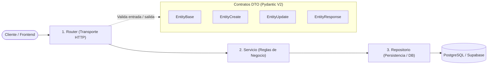

# FastAPI Enterprise API Builder Skill

Esta skill instruye al desarrollador y a los agentes de IA para diseñar, construir, auditar y desplegar **APIs REST profesionales y escalables** utilizando **FastAPI** y **Pydantic V2**, bajo los principios de la **Arquitectura Limpia en Capas** (*Clean / Layered Architecture*), sin dependencias en bases de datos embebidas o soluciones improvisadas.

---

## 🏛️ Principios Arquitectónicos Innegociables



1. **Separación Estricta de Capas (Layered Architecture):**
   * **Capa de Controladores (Routers):** Recibe la petición HTTP, delega la ejecución a la capa de servicio y retorna el código de estado adecuado. **Nunca ejecuta consultas SQL ni contiene lógica de negocio.**
   * **Capa de Lógica de Negocio (Servicios):** Implementa las reglas de validación y flujos de dominio (cálculos, restricciones, orquestación de operaciones).
   * **Capa de Persistencia (Repositorios):** Gestiona la comunicación con la base de datos (PostgreSQL / SQLModel / SQLAlchemy).
   * **Capa de Contratos (DTOs):** Esquemas Pydantic V2 que validan la entrada y moldean la salida.

2. **Los 4 Contratos DTO Obligatorios (Pydantic V2):**
   Toda entidad debe dividirse en 4 esquemas para prevenir fugas de campos sensibles y sobreescrituras accidentales:
   * `<Entity>Base`: Atributos comunes compartidos.
   * `<Entity>Create`: Atributos requeridos para registrar una nueva entidad.
   * `<Entity>Update`: Atributos opcionales para actualizaciones parciales (`PATCH`).
   * `<Entity>Response`: Atributos que ve el cliente (`id`, `created_at`, etc., excluyendo contraseñas o datos internos).

3. **Seguridad por Defecto (Auth Guard Standard):**
   * Todo nuevo endpoint de lectura, creación, modificación o eliminación debe nacer protegido obligatoriamente mediante inyección de dependencias de OAuth2 / JWT:
     ```python
     from fastapi import Depends
     from services.api.routes.auth import get_current_user

     current_user: dict = Depends(get_current_user)
     ```
   * Si un endpoint debe ser público (ej. `/auth/login` o `/health`), debe justificarse explícitamente.

4. **REST Canónico y Códigos de Estado HTTP Estrictos:**
   * `POST /recursos` $\rightarrow$ `status.HTTP_201_CREATED`
   * `GET /recursos` $\rightarrow$ `status.HTTP_200_OK`
   * `GET /recursos/{id}` $\rightarrow$ `status.HTTP_200_OK` (o `404 NOT FOUND`)
   * `PATCH /recursos/{id}` $\rightarrow$ `status.HTTP_200_OK`
   * `DELETE /recursos/{id}` $\rightarrow$ `status.HTTP_204_NO_CONTENT` o `200_OK`
   * Errores de validación $\rightarrow$ `status.HTTP_422_UNPROCESSABLE_ENTITY`
   * Conflictos de duplicidad $\rightarrow$ `status.HTTP_409_CONFLICT`

5. **Sanitización Defensiva de Excepciones (OWASP API Security):**
   * Prohibido permitir que excepciones no controladas de la base de datos (SQL errors, conexiones caídas) lleguen al cliente como un stack trace crudo.
   * Las excepciones internas se capturan y registran en el `logger`, devolviendo al cliente mensajes limpios y seguros.

6. **Testing Automatizado Obligatorio:**
   Todo módulo de API debe incluir su suite de pruebas unitarias y de integración en `tests/` con `fastapi.testclient.TestClient`:
   * Prueba de bloqueo sin autenticación (`401 Unauthorized`).
   * Prueba de rechazo de esquema inválido (`422 Unprocessable Entity`).
   * Prueba de ciclo completo exitoso (`200 OK` / `201 Created`).

7. **Gestión de Entorno con UV:**
   * Instalación de paquetes: `uv add <paquete>`. Prohibido usar `pip install`.
   * Ejecución de tests y servidor: `uv run pytest`, `uv run uvicorn`.

---

## 🗺️ Protocolo de Implementación Paso a Paso

---

### Paso 1: Definir los Contratos DTO con Pydantic V2

En la capa de modelos (`services/api/models.py`), define los 4 esquemas aplicando validadores modernos de Pydantic V2:

```python
from pydantic import BaseModel, Field
from typing import Optional
from datetime import datetime

class ResourceBase(BaseModel):
    name: str = Field(..., min_length=2, max_length=100, description="Nombre descriptivo")
    category: str = Field(..., min_length=2, max_length=50)
    status: str = Field(default="active", pattern="^(active|archived|pending)$")

class ResourceCreate(ResourceBase):
    code: str = Field(..., min_length=3, max_length=20, description="Código único de negocio")

class ResourceUpdate(BaseModel):
    name: Optional[str] = Field(default=None, min_length=2, max_length=100)
    category: Optional[str] = Field(default=None, min_length=2, max_length=50)
    status: Optional[str] = Field(default=None, pattern="^(active|archived|pending)$")

class ResourceResponse(ResourceBase):
    id: str
    code: str
    created_at: datetime
    updated_at: datetime

    class Config:
        from_attributes = True
```

---

### Paso 2: Capa de Persistencia / Repositorio (SQLModel / PostgreSQL)

En la capa de datos (`services/api/database.py` o módulo de repositorios), implementa operaciones CRUD puras:

```python
import uuid
from datetime import datetime
from typing import List, Optional, Dict, Any
from sqlmodel import Session, select

def get_resource_by_id(session: Session, resource_id: str) -> Optional[Any]:
    """Recupera un recurso por su ID único sin mezclar lógica HTTP."""
    statement = select(ResourceModel).where(ResourceModel.id == resource_id)
    return session.exec(statement).first()

def create_resource(session: Session, data: Dict[str, Any]) -> Any:
    """Registra una nueva entidad en la base de datos."""
    record = ResourceModel(**data)
    record.id = str(uuid.uuid4())
    record.created_at = datetime.utcnow()
    record.updated_at = record.created_at
    session.add(record)
    session.commit()
    session.refresh(record)
    return record

def list_resources(session: Session, skip: int = 0, limit: int = 50) -> List[Any]:
    """Lista recursos aplicando paginación canónica."""
    statement = select(ResourceModel).offset(skip).limit(limit)
    return list(session.exec(statement).all())
```

---

### Paso 3: Controlador APIRouter con Seguridad y Documentación

En `services/api/routes/<resource>.py`, implementa el controlador REST:

```python
import logging
from fastapi import APIRouter, Depends, HTTPException, status, Query
from typing import List, Any
from services.api.models import ResourceCreate, ResourceUpdate, ResourceResponse
from services.api.routes.auth import get_current_user
from services.api.database import get_session
from services.api import database

logger = logging.getLogger(__name__)

router = APIRouter(prefix="/resources", tags=["Recursos"])


@router.post(
    "",
    response_model=ResourceResponse,
    status_code=status.HTTP_201_CREATED,
    summary="Crear nuevo recurso",
    description="Endpoint protegido que valida el payload e inserta la entidad.",
)
def create_resource(
    payload: ResourceCreate,
    current_user: dict[str, Any] = Depends(get_current_user),  # Auth Guard
    session=Depends(get_session),
) -> ResourceResponse:
    try:
        new_record = database.create_resource(session, payload.model_dump())
        logger.info(f"Recurso creado exitosamente por usuario: {current_user.get('email')}")
        return ResourceResponse.model_validate(new_record)
    except Exception as exc:
        logger.error(f"Fallo al registrar recurso: {exc}", exc_info=True)
        raise HTTPException(
            status_code=status.HTTP_500_INTERNAL_SERVER_ERROR,
            detail="Error interno del servidor al procesar la solicitud.",
        )


@router.get(
    "/{resource_id}",
    response_model=ResourceResponse,
    status_code=status.HTTP_200_OK,
    summary="Obtener recurso por ID",
)
def get_resource(
    resource_id: str,
    current_user: dict[str, Any] = Depends(get_current_user),
    session=Depends(get_session),
) -> ResourceResponse:
    record = database.get_resource_by_id(session, resource_id)
    if not record:
        raise HTTPException(
            status_code=status.HTTP_404_NOT_FOUND,
            detail=f"Recurso con ID '{resource_id}' no encontrado.",
        )
    return ResourceResponse.model_validate(record)


@router.get(
    "",
    response_model=List[ResourceResponse],
    status_code=status.HTTP_200_OK,
    summary="Listar recursos con paginación",
)
def list_resources(
    skip: int = Query(default=0, ge=0, description="Registros a omitir"),
    limit: int = Query(default=50, ge=1, le=100, description="Límite por página"),
    current_user: dict[str, Any] = Depends(get_current_user),
    session=Depends(get_session),
) -> List[ResourceResponse]:
    records = database.list_resources(session, skip=skip, limit=limit)
    return [ResourceResponse.model_validate(r) for r in records]
```

---

### Paso 4: Registro Central del Router (`services/api/main.py`)

Añadir el router a la aplicación principal:

```python
from services.api.routes import resources

app.include_router(resources.router)
```

---

### Paso 5: Suite de Pruebas Automatizadas (`tests/api/test_<resource>.py`)

Validar la API contra regresiones con `TestClient`:

```python
from fastapi.testclient import TestClient
from services.api.main import app
from services.api.routes.auth import get_current_user

client = TestClient(app)

def test_resource_endpoint_unauthorized():
    """1. Verifica que peticiones sin token son rechazadas con 401."""
    response = client.post("/resources", json={"name": "Test", "code": "ABC-1"})
    assert response.status_code == 401

def test_resource_endpoint_validation_error():
    """2. Verifica que datos que violan el contrato Pydantic devuelven 422."""
    app.dependency_overrides[get_current_user] = lambda: {"id": "test-user", "email": "admin@nexova.com"}
    try:
        response = client.post("/resources", json={"name": "A", "code": "X"})  # Demasiado corto
        assert response.status_code == 422
    finally:
        app.dependency_overrides.clear()

def test_resource_endpoint_success():
    """3. Verifica la creación exitosa con 201 y formato correcto."""
    app.dependency_overrides[get_current_user] = lambda: {"id": "test-user", "email": "admin@nexova.com"}
    payload = {"name": "Servidor Cloud", "category": "Infraestructura", "code": "SRV-001"}
    try:
        response = client.post("/resources", json=payload)
        assert response.status_code == 201
        data = response.json()
        assert data["name"] == payload["name"]
        assert "id" in data
        assert "created_at" in data
    finally:
        app.dependency_overrides.clear()
```

---

## ✅ Criterios de Aceptación (Definition of Done)

- [ ] Se implementaron los 4 modelos DTO en Pydantic V2 (`Base`, `Create`, `Update`, `Response`).
- [ ] No existen referencias a motores embebidos de testing (cero dependencias en TinyDB).
- [ ] La capa de persistencia está completamente desacoplada de `HTTPException` y FastAPI.
- [ ] Todo endpoint de datos tiene inyectado el Auth Guard (`Depends(get_current_user)`).
- [ ] Los verbos y códigos de estado HTTP siguen el estándar canónico REST (`201`, `200`, `404`, `422`).
- [ ] La suite de tests cubre llamadas no autenticadas (401), validación (422) y éxito (201/200).
- [ ] El router está registrado en `services/api/main.py` y los tests pasan al 100% con `uv run pytest`.
