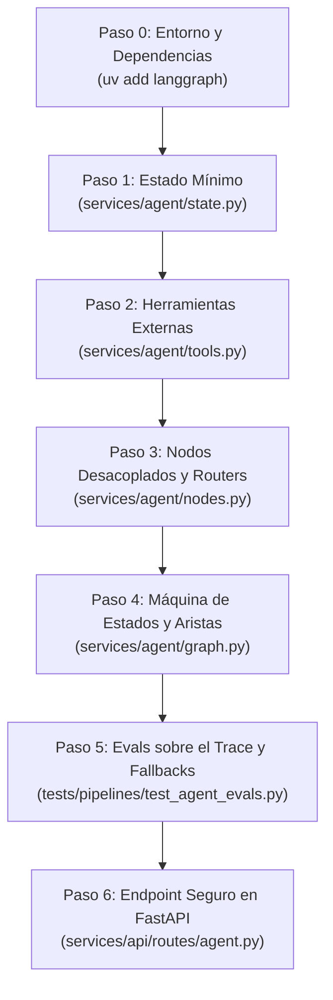
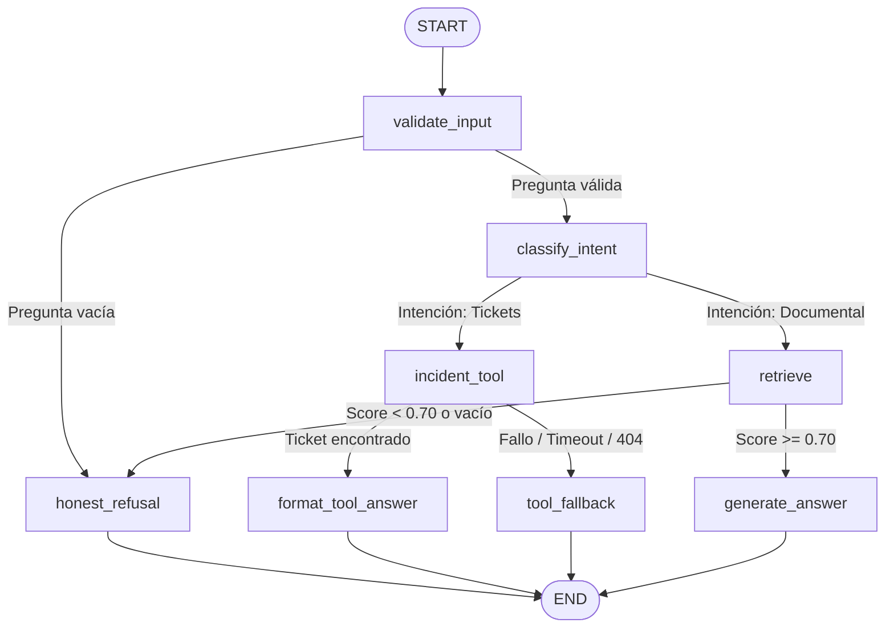

# LangGraph Agent Orchestrator Skill

Esta skill instruye al desarrollador o al agente de IA para construir, configurar, auditar y desplegar **Agentes de Inteligencia Artificial Híbridos Orquestados por Grafos de Estados**, utilizando **LangGraph** y **FastAPI**, siguiendo los más rigurosos estándares de producción y arquitectura limpia.

Su objetivo es transformar prototipos o flujos RAG monolíticos ("cajas negras") en máquinas de estados explícitas, transparentes y comprobables donde cada transición, llamada a herramienta externa o decisión documental sea auditable paso a paso.

---

## 🏛️ Principios Arquitectónicos Innegociables

1. **Cero Monolitos (Contrato de Nodos Estricto):**
   - Cada nodo debe cumplir el principio de **Responsabilidad Única** (*Single Responsibility Principle*).
   - Prohibido empaquetar la recuperación (`retrieve`) y la síntesis (`generate_answer`) en un único nodo. El nodo de recuperación solo alimenta el estado con fragmentos; el nodo de generación solo consume ese contexto para redactar.

2. **Diferenciación Estricta: "Conocimiento Documental" (RAG) vs. "Datos en Vivo" (Tools):**
   - **Prohibido indexar datos operativos transaccionales en bases vectoriales:** Los tickets, inventarios y estados de pedidos cambian en tiempo real. Un vector store queda desactualizado en minutos y exige re-indexaciones costosas e inútiles.
   - El RAG se reserva exclusivamente para conocimiento documental estable (políticas, manuales, FAQs).
   - Los datos operativos se consultan siempre en vivo mediante llamadas a herramientas externas (*Tool Calling*).

3. **Contrato de Herramientas Externas Defensivo:**
   - **Tipado Estricto:** Firma de entrada y salida clara con contratos tipados (ej. `Optional[Dict[str, Any]]`).
   - **Solo Lectura (`GET`):** Prevenir que herramientas no autorizadas muten el estado del negocio.
   - **Timeout Numérico Obligatorio:** Toda llamada externa debe fijar un timeout explícito (ej. `timeout=5.0` segundos).
   - **Captura Defensiva en el Nodo:** El nodo que invoca la tool debe capturar excepciones (`TimeoutError`, errores de red o 404) y redirigir a un nodo de contingencia (*fallback*) en lugar de propagar un error 500.

4. **Estado Mínimo y Explícito (`AgentState` con `TypedDict`):**
   - El estado debe ser fuertemente tipado e incluir:
     - `question: str`
     - `intent: Optional[str]` ("rag" | "incident_tool" | "unknown")
     - `context: List[Dict[str, Any]]`
     - `tool_data: Optional[Dict[str, Any]]`
     - `answer: str`
     - `error: Optional[str]`
     - `execution_trace: List[str]` (registra secuencialmente los nodos visitados).

5. **Bifurcaciones Condicionales Reales y Rutas de Fallback Honesto:**
   - **Guardia de Entrada:** Si la consulta viene vacía o inválida, se enruta inmediatamente a una salida con error/fin sin ejecutar búsqueda ni LLM.
   - **Enrutamiento Autónomo de Intención:** Un nodo clasificador determina si la pregunta requiere consulta documental (RAG) o una herramienta externa operativa, ahorrando costos y latencia.
   - **Guardia Anti-Alucinación:** Si la recuperación no supera el umbral de confianza (`min_score < 0.70` o lista vacía), el grafo bifurca hacia un nodo de **Rechazo Honesto** (*"No dispongo de información oficial sobre esa consulta"*).
   - **Guardia de Fallback para Tools:** Si la herramienta externa falla o no encuentra el registro, el grafo bifurca hacia un nodo de **Fallback Honesto** (*"No pude confirmar el estado de ese ticket ahora mismo"*), evitando inventar datos operativos inexistentes.

6. **Compilación en Tiempo de Construcción (*Build-Time*):**
   - El grafo debe compilarse explícitamente (`workflow.compile()`) antes de cualquier invocación para detectar nodos huérfanos o errores de tipado antes de producción.

7. **Checkpointing Obligatorio:**
   - Debe incorporarse un checkpointer (`MemorySaver` o persistencia en BD) para guardar snapshots del estado en cada transición relevante, permitiendo auditoría, inspección y reanudación por `thread_id`.

8. **Evals Deterministas sobre el Trace:**
   - Los tests verifican formalmente el orden y presencia de nodos dentro de `execution_trace`:
     - Consulta de tickets: `['validate_input', 'classify_intent', 'incident_tool', 'format_tool_answer']` (sin pasar por `retrieve`).
     - Consulta documental: `['validate_input', 'classify_intent', 'retrieve', 'generate_answer']` (sin tocar la tool).
     - Contingencia: `['validate_input', 'classify_intent', 'incident_tool', 'tool_fallback']`.

9. **Endpoint REST como Pasarela Limpia:**
   - El endpoint HTTP en FastAPI no contiene lógica de negocio; únicamente inicializa el estado e invoca `agent_app.invoke()`.
   - Obligatoriamente protegido por defecto (**Auth Guard Standard**) y retornando `execution_trace`, `intent` y `tool_data`.

---

## 🗺️ Protocolo de Ejecución Paso a Paso



---

### Paso 0: Entorno y Dependencias

Asegurar la instalación de dependencias mediante `uv` (prohibido `pip`):
```bash
uv add langgraph
```

---

### Paso 1: Definir el Estado Mínimo (`services/agent/state.py`)

Crear la definición estricta del esquema de datos que viaja por el grafo:

```python
from typing import TypedDict, List, Dict, Any, Optional

class AgentState(TypedDict, total=False):
    question: str
    intent: Optional[str]              # "rag" | "incident_tool" | "unknown"
    context: List[Dict[str, Any]]      # Fragmentos recuperados del RAG
    tool_data: Optional[Dict[str, Any]]# Datos devueltos por la herramienta externa
    answer: str                        # Respuesta final o mensaje honesto
    error: Optional[str]
    execution_trace: List[str]         # Trace secuencial auditable
```

---

### Paso 2: Herramientas Externas de Solo Lectura (`services/agent/tools.py`)

Contrato tipado de consulta operativa con timeout explícito y manejo defensivo:

```python
import logging
from typing import Optional, Dict, Any

logger = logging.getLogger("agent.tools")

def get_incident_ticket(ticket_identifier: str, timeout: float = 5.0) -> Optional[Dict[str, Any]]:
    """
    Consulta un ticket en el gestor de incidentes en tiempo real.
    Estrictamente de solo lectura (GET) con timeout explícito numérico.
    """
    clean_id = str(ticket_identifier).strip().lstrip("#")
    try:
        # Llamada en-proceso al repositorio o HTTP client con timeout=timeout
        # Retorna el diccionario con id, title, status, category, etc.
        data = fetch_incident_from_db_or_service(clean_id, timeout=timeout)
        return data
    except TimeoutError as exc:
        logger.warning(f"Timeout de {timeout}s agotado al consultar ticket '{clean_id}': {exc}")
        return None
    except Exception as exc:
        logger.error(f"Error consultando ticket '{clean_id}': {exc}")
        return None
```

---

### Paso 3: Nodos con Responsabilidad Única (`services/agent/nodes.py`)

Cada nodo es una función pura que actualiza campos específicos y anexa su nombre a `execution_trace`:

```python
import re
from typing import Dict, Any
from services.agent.state import AgentState
from services.agent.tools import get_incident_ticket

def validate_input_node(state: AgentState) -> Dict[str, Any]:
    question = state.get("question", "").strip()
    trace = list(state.get("execution_trace", [])) + ["validate_input"]
    if not question:
        return {
            "question": "",
            "error": "empty_question",
            "answer": "La consulta no puede estar vacía.",
            "execution_trace": trace,
        }
    return {"question": question, "error": None, "execution_trace": trace}

def classify_intent_node(state: AgentState) -> Dict[str, Any]:
    trace = list(state.get("execution_trace", [])) + ["classify_intent"]
    q = state["question"].lower()
    intent = "incident_tool" if any(w in q for w in ["ticket", "incidencia", "incidente", "reporte"]) else "rag"
    return {"intent": intent, "execution_trace": trace}

def incident_tool_node(state: AgentState) -> Dict[str, Any]:
    trace = list(state.get("execution_trace", [])) + ["incident_tool"]
    digits = re.search(r"\d+", state["question"])
    ticket_id = digits.group(0) if digits else state["question"]
    try:
        data = get_incident_ticket(ticket_id, timeout=5.0)
        error = None if data else "ticket_not_found"
    except Exception:
        data, error = None, "tool_timeout_or_error"
    return {"tool_data": data, "error": error, "execution_trace": trace}

def format_tool_answer_node(state: AgentState) -> Dict[str, Any]:
    trace = list(state.get("execution_trace", [])) + ["format_tool_answer"]
    d = state.get("tool_data") or {}
    return {
        "answer": f"El ticket '{d.get('title')}' está actualmente en estado: **{d.get('status')}**.",
        "execution_trace": trace,
    }

def tool_fallback_node(state: AgentState) -> Dict[str, Any]:
    trace = list(state.get("execution_trace", [])) + ["tool_fallback"]
    return {
        "answer": "No pude confirmar el estado de ese ticket ahora mismo. Por favor, verifica el identificador o inténtalo más tarde.",
        "execution_trace": trace,
    }

def retrieve_node(state: AgentState) -> Dict[str, Any]:
    trace = list(state.get("execution_trace", [])) + ["retrieve"]
    context = your_retrieve_function(state["question"], min_score=0.70)
    return {"context": context, "execution_trace": trace}

def honest_refusal_node(state: AgentState) -> Dict[str, Any]:
    trace = list(state.get("execution_trace", [])) + ["honest_refusal"]
    return {
        "answer": "Lo siento, la documentación oficial no contiene información suficiente sobre esa consulta.",
        "execution_trace": trace,
    }

def generate_answer_node(state: AgentState) -> Dict[str, Any]:
    trace = list(state.get("execution_trace", [])) + ["generate_answer"]
    answer = your_generate_answer_function(state["question"], state.get("context", []))
    return {"answer": answer, "execution_trace": trace}
```

---

### Paso 4: Grafo, Aristas Condicionales y Checkpointer (`services/agent/graph.py`)

Ensamblar el `StateGraph`, definir los routers condicionales y compilar:



```python
from typing import Optional
from langgraph.graph import StateGraph, START, END
from langgraph.checkpoint.memory import MemorySaver
from services.agent.state import AgentState
from services.agent.nodes import (
    validate_input_node, classify_intent_node, incident_tool_node,
    format_tool_answer_node, tool_fallback_node, retrieve_node,
    honest_refusal_node, generate_answer_node,
)

def route_after_validation(state: AgentState) -> str:
    return "honest_refusal" if state.get("error") else "classify_intent"

def route_after_intent(state: AgentState) -> str:
    return "incident_tool" if state.get("intent") == "incident_tool" else "retrieve"

def route_after_tool(state: AgentState) -> str:
    return "format_tool_answer" if state.get("tool_data") else "tool_fallback"

def route_after_retrieval(state: AgentState) -> str:
    return "generate_answer" if state.get("context") else "honest_refusal"

def create_agent_graph(checkpointer: Optional[MemorySaver] = None):
    workflow = StateGraph(AgentState)

    workflow.add_node("validate_input", validate_input_node)
    workflow.add_node("classify_intent", classify_intent_node)
    workflow.add_node("incident_tool", incident_tool_node)
    workflow.add_node("format_tool_answer", format_tool_answer_node)
    workflow.add_node("tool_fallback", tool_fallback_node)
    workflow.add_node("retrieve", retrieve_node)
    workflow.add_node("honest_refusal", honest_refusal_node)
    workflow.add_node("generate_answer", generate_answer_node)

    workflow.add_edge(START, "validate_input")
    workflow.add_conditional_edges("validate_input", route_after_validation)
    workflow.add_conditional_edges("classify_intent", route_after_intent)
    workflow.add_conditional_edges("incident_tool", route_after_tool)
    workflow.add_conditional_edges("retrieve", route_after_retrieval)

    workflow.add_edge("format_tool_answer", END)
    workflow.add_edge("tool_fallback", END)
    workflow.add_edge("honest_refusal", END)
    workflow.add_edge("generate_answer", END)

    active_checkpointer = checkpointer if checkpointer is not None else MemorySaver()
    return workflow.compile(checkpointer=active_checkpointer)

agent_app = create_agent_graph(MemorySaver())
```

---

### Paso 5: Suite de Evals Deterministas (`tests/pipelines/test_agent_evals.py`)

Escribir evals que validen el enrutamiento formal sin llamadas ciegas al LLM:

1. **Ruta Tool:** Verifica `trace == ['validate_input', 'classify_intent', 'incident_tool', 'format_tool_answer']` y que `retrieve` **no** se ejecute.
2. **Ruta RAG:** Verifica `trace == ['validate_input', 'classify_intent', 'retrieve', 'generate_answer']` y que `incident_tool` **no** se ejecute.
3. **Fallback por 404:** Con ticket inexistente, verifica `tool_fallback` en el trace y mensaje honesto.
4. **Resiliencia ante Timeout:** Simula `TimeoutError(side_effect=...)` en la tool y asegura que no lance error 500.

---

### Paso 6: Endpoint Seguro en FastAPI (`services/api/routes/agent.py`)

Exponer el agente con **Auth Guard Standard**, devolviendo la trazabilidad completa:

```python
from fastapi import APIRouter, Depends, HTTPException, status
from pydantic import BaseModel, Field
from typing import Optional, Dict, Any
from services.api.routes.auth import get_current_user
from services.agent.graph import agent_app

router = APIRouter(prefix="/agent", tags=["Agente Orquestado"])

class AgentQueryRequest(BaseModel):
    question: str = Field(..., min_length=1, max_length=1000)
    thread_id: Optional[str] = None

class AgentQueryResponse(BaseModel):
    question: str
    answer: str
    execution_trace: list[str]
    sources_count: int
    thread_id: str
    intent: Optional[str] = None
    tool_data: Optional[Dict[str, Any]] = None
    error: Optional[str] = None

@router.post("/query", response_model=AgentQueryResponse)
def query_agent(
    payload: AgentQueryRequest,
    current_user: dict[str, Any] = Depends(get_current_user), # Auth Guard Standard
):
    thread_id = payload.thread_id or str(uuid.uuid4())
    config = {"configurable": {"thread_id": thread_id}}
    initial_state = {
        "question": payload.question,
        "context": [],
        "answer": "",
        "error": None,
        "execution_trace": [],
    }
    try:
        final_state = agent_app.invoke(initial_state, config=config)
    except Exception as exc:
        raise HTTPException(
            status_code=status.HTTP_500_INTERNAL_SERVER_ERROR,
            detail="Error interno al procesar la consulta en el flujo del agente.",
        )
    return AgentQueryResponse(
        question=final_state["question"],
        answer=final_state["answer"],
        execution_trace=final_state["execution_trace"],
        sources_count=len(final_state.get("context", [])),
        thread_id=thread_id,
        intent=final_state.get("intent"),
        tool_data=final_state.get("tool_data"),
        error=final_state.get("error"),
    )
```

---

## ✅ Criterios de Aceptación (Definition of Done)

- [ ] El estado del grafo está tipado con `TypedDict` e incluye `intent`, `tool_data` y `execution_trace`.
- [ ] No se indexan datos transaccionales en bases vectoriales; las consultas operativas usan tools en tiempo real.
- [ ] Las herramientas externas son de solo lectura (`GET`), con tipado estricto y timeout explícito (5.0s).
- [ ] El clasificador de intenciones enruta autónomamente entre RAG y Tools sin intervención del usuario.
- [ ] Existen rutas de contingencia honesta tanto para RAG (`honest_refusal`) como para Tools (`tool_fallback`).
- [ ] El grafo se compila en tiempo de carga (`workflow.compile()`) y soporta snapshots vía checkpointer.
- [ ] La suite de evals deterministas pasa al 100% verificando las rutas RAG, Tool, 404 y timeout.
- [ ] El endpoint REST está protegido por autenticación (**Auth Guard Standard**) y devuelve trazabilidad completa.
