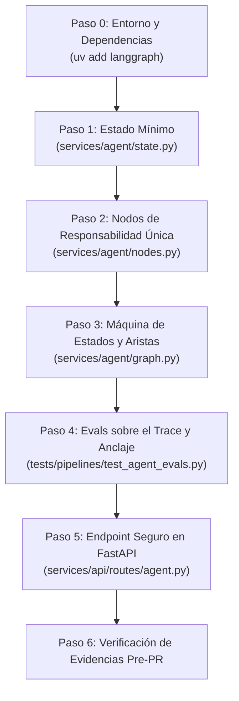

# LangGraph Agent Orchestrator Skill

Esta skill instruye al desarrollador o al agente de IA para construir, configurar, auditar y desplegar **Agentes de Inteligencia Artificial Orquestados por Grafos de Estados**, utilizando **LangGraph** y **FastAPI**, siguiendo los más rigurosos estándares de producción y arquitectura limpia.

Su objetivo es transformar prototipos o flujos RAG monolíticos ("cajas negras") en máquinas de estados explícitas, transparentes y comprobables donde cada transición y decisión sea auditable paso a paso.

---

## 🏛️ Principios Arquitectónicos Innegociables

1. **Cero Monolitos (Contrato de Nodos Estricto):**
   - Cada nodo debe cumplir el principio de **Responsabilidad Única** (*Single Responsibility Principle*).
   - Prohibido empaquetar la recuperación (`retrieve`) y la síntesis (`generate_answer`) en un único nodo. El nodo de recuperación solo alimenta el estado con fragmentos; el nodo de generación solo consume ese contexto para redactar.

2. **Estado Mínimo y Explícito (`AgentState` con `TypedDict`):**
   - El estado no debe arrastrar historiales de conversación innecesarios sin justificación.
   - Debe incluir obligatoriamente un campo `execution_trace: List[str]` que registre secuencialmente los nodos visitados en tiempo de ejecución (`["validate_input", "retrieve", ...]`).

3. **Bifurcaciones Condicionales Reales (Anti-Alucinaciones y Ahorro de Tokens):**
   - Ningún agente debe modelarse como una secuencia rígida o línea recta.
   - **Guardia de Entrada:** Si la consulta viene vacía o inválida, se enruta inmediatamente a una salida con error/fin sin ejecutar búsqueda ni LLM.
   - **Enrutamiento Autónomo de Intenciones:** Un nodo clasificador determina si la pregunta requiere consulta documental (RAG) o una herramienta externa operativa en tiempo real (Tickets, Inventario, etc.), evitando invocar el recuperador vectorial innecesariamente.
   - **Guardia Anti-Alucinación:** Si la recuperación no supera el umbral de confianza (`min_score < 0.70` o lista vacía), el grafo debe bifurcar hacia un nodo de **Rechazo Honesto** (*"No dispongo de información oficial sobre esa consulta"*), evitando forzar la generación sobre el vacío.
   - **Herramientas de Solo Lectura con Timeout y Fallback:** Toda herramienta externa debe ser estrictamente de solo lectura (`GET`), con timeout numérico explícito (ej. 5.0s), y encapsulada con `try...except` para redirigir a un nodo de contingencia honesto ante caídas o identificadores no encontrados.

4. **Compilación en Tiempo de Construcción (*Build-Time*):**
   - El grafo debe compilarse explícitamente (`workflow.compile()`) antes de cualquier invocación para detectar nodos huérfanos o errores de tipado antes de producción.

5. **Checkpointing Obligatorio:**
   - Debe incorporarse un checkpointer (por defecto `MemorySaver` para memoria volátil o persistencia en BD) para guardar snapshots del estado en cada transición relevante, permitiendo auditoría, inspección y reanudación por `thread_id`.

6. **Evals Deterministas sobre el Trace:**
   - La suite de evaluación no debe depender de llamadas ciegas al LLM cada vez. Los evals verifican formalmente el orden y presencia de nodos dentro de `execution_trace` y el anclaje fáctico con respecto al corpus documental oficial.

7. **Endpoint REST como Pasarela Limpia:**
   - El endpoint HTTP en FastAPI no debe contener lógica de negocio propia; únicamente inicializa el estado e invoca `agent_app.invoke()`.
   - Obligatoriamente protegido por defecto (**Auth Guard Standard**) y con captura de excepciones que oculte stack traces internos.

---

## 🗺️ Protocolo de Ejecución Paso a Paso



---

### Paso 0: Entorno y Dependencias

Asegurar la instalación de LangGraph mediante `uv` (prohibido `pip`):
```bash
uv add langgraph
```

---

### Paso 1: Definir el Estado Mínimo (`services/agent/state.py`)

Crear la definición estricta del esquema de datos que viaja por el grafo:

```python
from typing import TypedDict, List, Dict, Any, Optional

class AgentState(TypedDict):
    question: str
    context: List[Dict[str, Any]]
    answer: str
    error: Optional[str]
    execution_trace: List[str]
```

---

### Paso 2: Nodos con Responsabilidad Única (`services/agent/nodes.py`)

Cada nodo es una función pura que recibe `state: AgentState` y retorna un diccionario con los campos que actualiza, anexando su nombre al `execution_trace`:

```python
from typing import Dict, Any
from services.agent.state import AgentState

def validate_input_node(state: AgentState) -> Dict[str, Any]:
    question = state.get("question", "").strip()
    trace = list(state.get("execution_trace", [])) + ["validate_input"]
    if not question:
        return {
            "question": "",
            "error": "empty_question",
            "answer": "La consulta no puede estar vacía.",
            "execution_trace": trace,
        }
    return {"question": question, "error": None, "execution_trace": trace}

def retrieve_node(state: AgentState) -> Dict[str, Any]:
    trace = list(state.get("execution_trace", [])) + ["retrieve"]
    # Invocar la función de recuperación con umbral de similitud
    context = your_retrieve_function(state["question"], min_score=0.70)
    return {"context": context, "execution_trace": trace}

def honest_refusal_node(state: AgentState) -> Dict[str, Any]:
    trace = list(state.get("execution_trace", [])) + ["honest_refusal"]
    return {
        "answer": "Lo siento, la documentación oficial no contiene información sobre esa consulta.",
        "execution_trace": trace,
    }

def generate_answer_node(state: AgentState) -> Dict[str, Any]:
    trace = list(state.get("execution_trace", [])) + ["generate_answer"]
    answer = your_generate_answer_function(state["question"], state.get("context", []))
    return {"answer": answer, "execution_trace": trace}
```

---

### Paso 3: Grafo, Aristas Condicionales y Checkpointer (`services/agent/graph.py`)

Ensamblar el `StateGraph`, definir los routers condicionales y compilar:

```python
from typing import Optional
from langgraph.graph import StateGraph, START, END
from langgraph.checkpoint.memory import MemorySaver
from services.agent.state import AgentState
from services.agent.nodes import (
    validate_input_node,
    retrieve_node,
    honest_refusal_node,
    generate_answer_node,
)

def route_after_validation(state: AgentState) -> str:
    if state.get("error"):
        return "honest_refusal"
    return "retrieve"

def route_after_retrieval(state: AgentState) -> str:
    context = state.get("context", [])
    if context and len(context) > 0:
        return "generate_answer"
    return "honest_refusal"

def create_agent_graph(checkpointer: Optional[MemorySaver] = None):
    workflow = StateGraph(AgentState)

    workflow.add_node("validate_input", validate_input_node)
    workflow.add_node("retrieve", retrieve_node)
    workflow.add_node("honest_refusal", honest_refusal_node)
    workflow.add_node("generate_answer", generate_answer_node)

    workflow.add_edge(START, "validate_input")

    workflow.add_conditional_edges(
        "validate_input",
        route_after_validation,
        {"retrieve": "retrieve", "honest_refusal": "honest_refusal"},
    )
    workflow.add_conditional_edges(
        "retrieve",
        route_after_retrieval,
        {"generate_answer": "generate_answer", "honest_refusal": "honest_refusal"},
    )

    workflow.add_edge("honest_refusal", END)
    workflow.add_edge("generate_answer", END)

    active_checkpointer = checkpointer if checkpointer is not None else MemorySaver()
    return workflow.compile(checkpointer=active_checkpointer)

agent_app = create_agent_graph(MemorySaver())
```

---

### Paso 4: Suite de Evals Deterministas (`tests/pipelines/test_agent_evals.py`)

Escribir al menos 3 evals obligatorios verificando:
1. **Bifurcación ante consulta vacía:** `trace == ["validate_input", "honest_refusal"]`.
2. **Orden estricto de ejecución:** `trace.index("retrieve") < trace.index("generate_answer")`.
3. **Guardia anti-alucinación:** Si `context == []`, se enruta a `honest_refusal` sin llamar al LLM.
4. **Anclaje Fáctico:** La respuesta contiene las entidades/datos numéricos del documento oficial.
5. **Inspección de Checkpoints:** `app.get_state({"configurable": {"thread_id": ...}})` recupera el snapshot idéntico al resultado final.

---

### Paso 5: Endpoint Seguro en FastAPI (`services/api/routes/agent.py`)

Exponer el agente mediante una pasarela desacoplada con **Auth Guard**:

```python
from fastapi import APIRouter, Depends, HTTPException, status
from pydantic import BaseModel, Field
from typing import Optional, Any
from services.agent.graph import agent_app

router = APIRouter(prefix="/agent", tags=["Agente Orquestado"])

class AgentQueryRequest(BaseModel):
    question: str = Field(..., min_length=1, max_length=1000)
    thread_id: Optional[str] = None

@router.post("/query")
def query_agent(
    payload: AgentQueryRequest,
    current_user: dict[str, Any] = Depends(get_current_user), # Auth Guard Standard
):
    thread_id = payload.thread_id or str(uuid.uuid4())
    config = {"configurable": {"thread_id": thread_id}}
    initial_state = {
        "question": payload.question,
        "context": [],
        "answer": "",
        "error": None,
        "execution_trace": [],
    }
    try:
        final_state = agent_app.invoke(initial_state, config=config)
    except Exception as exc:
        raise HTTPException(
            status_code=status.HTTP_500_INTERNAL_SERVER_ERROR,
            detail="Error interno al procesar la consulta en el flujo del agente.",
        )
    return {
        "question": final_state["question"],
        "answer": final_state["answer"],
        "execution_trace": final_state["execution_trace"],
        "thread_id": thread_id,
    }
```

---

## ✅ Criterios de Aceptación (Definition of Done)

- [ ] El estado del grafo es mínimo, tipado con `TypedDict` y registra `execution_trace`.
- [ ] No existe ninguna función monolítica `query()` empaquetada dentro de un solo nodo.
- [ ] Existen al menos dos aristas condicionales reales (salida rápida y anti-alucinaciones).
- [ ] El grafo se compila en tiempo de carga antes de recibir cualquier petición.
- [ ] El checkpointer almacena snapshots consultables por `thread_id`.
- [ ] La suite de evals pasa al 100% con cero warnings.
- [ ] El endpoint HTTP está protegido por autenticación y maneja excepciones defensivamente.

