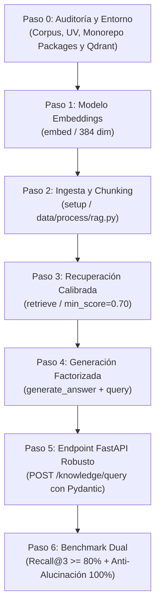

# Qdrant RAG Builder Skill

Esta skill instruye al agente para construir, configurar, auditar y desplegar sistemas **RAG (Retrieval-Augmented Generation)** modulares, robustos y de grado de producción, utilizando el SDK nativo de **Qdrant** y **FastAPI**, **sin frameworks de orquestación pesados** (sin LangChain ni LlamaIndex).

Está diseñada tanto para ejecutarse de forma autónoma paso a paso como para proveer funciones reutilizables por agentes orquestadores posteriores (como LangGraph).

---

## 🏛️ Principios Arquitectónicos Innegociables

1. **Separación de Responsabilidades ("Dos modelos, dos trabajos"):**
   - El modelo de **embeddings** (`fastembed` / `bge-small-en-v1.5`, 384 dim) convierte texto en vectores densos.
   - El modelo **LLM de generación** (vía `/chat/completions`) redacta la respuesta final usando el contexto recuperado. Nunca se reutiliza el modelo de generación para calcular embeddings.
2. **Los 4 Puntos de Entrada Modulares:**
   - `setup()`: Ingesta, chunking semántico e indexación idempotente en `data/process/rag.py`.
   - `embed()`: Vectorización estándar compartida para chunks y consultas.
   - `retrieve()`: Búsqueda KNN con **filtro obligatorio por umbral (`min_score`)** en `data/pipelines/rag.py`.
   - `query()`: Composición desacoplada de `retrieve()` + `generate_answer()` en `data/pipelines/rag.py`.
3. **Paso de Generación Factorizado para Agentes:**
   - La función `generate_answer(question: str, context: list[dict]) -> str` debe existir de forma independiente para permitir que agentes futuros (LangGraph) invoquen recuperación y generación como pasos separados sin duplicar llamadas.
4. **Cero Alucinaciones y Umbral Estricto (`min_score >= 0.70`):**
   - `retrieve()` nunca fuerza $K$ resultados si no superan el umbral de similitud. Si no hay contexto suficiente, el LLM debe responder con honestidad declarando que la base de conocimiento no contiene esa información.
5. **Cero Fuga de Raw Vectors vs Transparencia de Fuentes:**
   - Nunca deben exponerse arrays densos de vectores (`point.vector`) al cliente.
   - **Recomendado:** Retornar metadatos estructurados de las fuentes citadas (`source_document`, `section` y porcentaje de similitud) para auditoría y trazabilidad visual en la UI.

---

## 🗺️ Protocolo de Ejecución Paso a Paso



---

### Paso 0: Descubrimiento, Corpus, Estructura de Paquetes y Dependencias

1. **Localizar el Corpus de Conocimiento:**
   - Verificar los documentos fuente en `docs/company-knowledge-base/` (archivos `.md` o `.txt`).
   - Identificar las entidades, políticas y servicios definidos en el briefing de la empresa.

2. **Estructura de Paquetes en Monorepos (`PYTHONPATH`):**
   - Crear los archivos de inicialización de paquete para evitar errores `ModuleNotFoundError: No module named 'data'`:
     - `data/__init__.py`
     - `data/process/__init__.py`
     - `data/pipelines/__init__.py`
   - Configurar en `pyproject.toml`:
     ```toml
     [tool.pytest.ini_options]
     pythonpath = ["."]
     ```

3. **Asegurar Dependencias con UV (Prohibido pip):**
   ```bash
   uv add qdrant-client fastembed httpx python-dotenv
   ```

4. **Infraestructura Qdrant:**
   - Verificar si Qdrant corre en contenedor Docker (`localhost:6333` vía `docker-compose.yml`), en Qdrant Cloud o en modo embebido local.
   - En `docker-compose.yml`:
     ```yaml
     qdrant:
       image: qdrant/qdrant:v1.12.0
       container_name: nexova-qdrant
       ports:
         - "6333:6333"
       volumes:
         - qdrant_data:/qdrant/storage
     ```
   - *Nota de compatibilidad:* Si el cliente `qdrant-client` es más reciente que el servidor (ej. 1.20 vs 1.12), inicializar con `check_compatibility=False` para evitar advertencias en runtime:
     ```python
     client = QdrantClient(url=QDRANT_URL, check_compatibility=False)
     ```

---

### Paso 1: Configuración de Embeddings Dedicados

Implementar la función `embed(text: str) -> list[float]` que será compartida tanto para indexar chunks como para vectorizar la consulta del usuario:

* **Modelo Recomendado (ONNX Local):** `fastembed` con `BAAI/bge-small-en-v1.5`
  - **Dimensión:** `384`
  - **Métrica de distancia:** `Distance.COSINE`
  - **Ventajas:** 100% privado, bajo consumo de memoria (~67 MB), sin coste de API ni rate-limits.

```python
from fastembed import TextEmbedding

embedding_model = TextEmbedding(model_name="BAAI/bge-small-en-v1.5")

def embed(text: str) -> list[float]:
    """Genera vector float de 384 dimensiones a partir de un texto."""
    return list(embedding_model.embed([text]))[0].tolist()
```

---

### Paso 2: Ingesta, Chunking Semántico e Indexación Idempotente (`setup()`)

Ubicar en `data/process/rag.py`.

#### Reglas de Chunking Semántico:
- **Prohibido:** No dividir por un número fijo y ciego de caracteres (ej. trocear cada 500 caracteres corta políticas, condiciones y tablas por la mitad).
- **Estrategia Obligatoria:** Dividir por encabezados Markdown (`#`, `##`, `###`) o bloques de procedimientos completos. Cada chunk debe ser una unidad autocontenida que incluya el título de su sección.

#### Esquema del Payload en Qdrant:
Cada punto indexado debe contener como mínimo:
```python
payload = {
    "source_document": "nombre_archivo.md",
    "section": "Título de la Sección o Política",
    "company": "Nombre de la Empresa",
    "language": "es",
    "chunk_index": i,
    "text": "Cuerpo completo del fragmento semántico...",
}
```

#### Idempotencia:
`setup()` debe ser completamente idempotente en desarrollo: invocar `client.recreate_collection(...)` para limpiar y recargar sin duplicar puntos ni acumular basura.

---

### Paso 3: Recuperación Semántica con Umbral Calibrado (`retrieve()`)

Ubicar en `data/pipelines/rag.py`.

* **Calibración Obligatoria del Umbral (`min_score = 0.70`):**
  - **Por qué 0.70 y no 0.65:** En corpus en español con modelos de embeddings densos en inglés/multilingües (`bge-small`), consultas fuera de dominio que compartan entidades geográficas o léxicas (*"Valencia"*, *"España"*) pueden obtener similitudes de **0.65 a 0.68**. Con un umbral de `0.65` se producen falsos positivos; un umbral de `0.70` aísla las consultas dentro de dominio (0.71 a 0.85) de las irrelevantes (< 0.68).
  - La función debe devolver una lista de payloads limpios (diccionarios), **nunca objetos crudos del SDK de Qdrant**.

```python
def retrieve(
    query: str,
    *,
    k: int = 5,
    min_score: float = 0.70,
    client: QdrantClient | None = None,
    collection_name: str = COLLECTION_NAME,
) -> list[dict]:
    if client is None:
        client = get_qdrant_client()

    query_vector = embed(query)
    search_result = client.query_points(
        collection_name=collection_name,
        query=query_vector,
        limit=k,
        score_threshold=min_score,
    )
    # Incluye el score de similitud en el payload para trazabilidad y auditoría
    results = []
    for point in search_result.points:
        if point.payload:
            payload_copy = dict(point.payload)
            payload_copy["similarity_score"] = round(float(point.score), 4)
            results.append(payload_copy)
    return results
```

---

### Paso 4: Generación Desacoplada y Punto de Entrada Único

Ubicar en `data/pipelines/rag.py`.

1. **`generate_answer(question: str, context: list[dict]) -> str`:**
   - Factorizada de manera independiente.
   - Si `context` es una lista vacía: responder honestamente (ej. *"Lo siento, la documentación corporativa actual de la empresa no contiene información sobre esa consulta."*).
   - Inyectar en el System Prompt la **voz y audiencia del negocio** (según el briefing de la empresa).
   - Llamar al endpoint universal compatible `/chat/completions` (Ollama local, Groq o proxy de aula) con `temperature=0.0` o `0.1` para máxima precisión fáctica.
2. **`query(question: str) -> str`:**
   - Función principal que compone el flujo:
   ```python
   def query(question: str) -> str:
       context = retrieve(question, k=5, min_score=0.70)
       return generate_answer(question, context)
   ```

---

### Paso 5: Exposición vía API REST Robusta (`services/api/routes/knowledge.py`)

- Endpoint: `POST /knowledge/query` y `POST /api/knowledge/query`.
- **Validación con Pydantic:**
  ```python
  from pydantic import BaseModel, Field

  class KnowledgeQueryRequest(BaseModel):
      question: str = Field(..., min_length=3, max_length=1000, description="Consulta del usuario")
      k: int = Field(default=5, ge=1, le=20, description="Máximo de fragmentos a recuperar")
      min_score: float = Field(default=0.70, ge=0.0, le=1.0, description="Umbral de corte de similitud")

  class SourceCitation(BaseModel):
      document: str
      section: str
      score: float

  class KnowledgeQueryResponse(BaseModel):
      answer: str
      sources: list[SourceCitation] = []
  ```
- **Auth Guard Obligatorio:** Protegido con `Depends(get_current_user)`.
- No debe contener lógica de recuperación duplicada en el router; delega en `data.pipelines.rag`.

---

### Paso 6: Suite de Pruebas y Benchmark Dual de Evaluación

1. **Tests Unitarios en `tests/pipelines/test_rag.py`:**
   - Probar que `retrieve()` filtre correctamente puntos por debajo de `min_score` usando un cliente simulado (`unittest.mock.MagicMock`).
   - Probar que `generate_answer()` devuelva el mensaje honesto cuando el contexto está vacío.
   - Probar que `query()` orquesta `retrieve()` y `generate_answer()` secuencialmente.
   - Probar que el endpoint HTTP bloquee accesos anónimos con **HTTP 401**.
   - Ejecución: `uv run pytest tests/pipelines/test_rag.py -v`.

2. **Evaluación Formal Dual (`Recall@3` + Anti-Alucinaciones):**
   - Crear `data/eval/test-queries.json` con al menos 8 preguntas dentro de dominio cubriendo todos los documentos del corpus y al menos 1-2 preguntas fuera de dominio (`expected_in_context: false`).
   - Crear y ejecutar un script de benchmarking (`scripts/evaluate_rag.py`) que compruebe:
     1. **$\text{Recall@3} \ge 80\%$** en consultas dentro de dominio.
     2. **$\text{Anti-Hallucination Rate} = 100\%$** en consultas fuera de dominio (0 fragmentos recuperados y respuesta honesta activada).
     3. **Latencia media** de recuperación $< 500\text{ ms}$.

---

## 🤖 Interacción con Agentes Orquestadores (LangGraph / Multi-Agent)

Cuando un agente orquestador inteligente requiera consultar la base de conocimiento:
* **Herramienta de Búsqueda:** El agente importa y utiliza `retrieve(query, k=3, min_score=0.70)` para examinar el contexto crudo y tomar decisiones de razonamiento.
* **Herramienta de Respuesta Directa:** El agente puede invocar `generate_answer(question, context)` o delegar la respuesta a su propio ciclo conversacional.
* Esta separación garantiza que el agente no esté obligado a ejecutar el monolito de `query()` a ciegas.

---

## 🌟 Caso de Referencia Canónico: Nexova Solutions

A continuación se presenta un caso de referencia real implementado y auditado en producción:

### 1. Corpus Indexado (15 Chunks Semánticos)
* `politicas_contratacion_seleccion.md` (Garantías de 90 días, tarifas 18-22%, onboarding).
* `catalogo_outsourcing_soporte.md` (Coberturas 8x5 vs 24x7, perfiles L1/L2, ticketing).
* `slas_y_niveles_servicio.md` (Severidades P1 a P4, tiempos de respuesta < 15 min, penalizaciones).
* `catalogo_formacion_corporativa.md` (Programas de liderazgo, bonificaciones FUNDAE).

### 2. Ejemplo Real de Payload Indexado
```json
{
  "source_document": "politicas_contratacion_seleccion.md",
  "document_title": "Políticas de Contratación y Selección de Personal",
  "section": "Garantía de Reposición y Continuidad",
  "company": "Nexova Solutions",
  "language": "es",
  "chunk_index": 2,
  "text": "Si un candidato seleccionado abandona voluntariamente su puesto o no supera el periodo de prueba dentro de los primeros 90 días naturales, Nexova iniciará un nuevo proceso de selección sin coste adicional..."
}
```

### 3. Ejemplo de Consulta In-Domain vs Out-of-Domain
* **Consulta Dentro de Dominio:**  
  *Pregunta:* *"¿Cuál es la garantía de reposición en headhunting?"*  
  *Similitud:* `0.8145` (Fragmento recuperado: `Garantía de Reposición y Continuidad`).  
  *Respuesta:* Sintetizada por el LLM confirmando los 90 días naturales de cobertura gratuita.
* **Consulta Fuera de Dominio (Control Anti-Alucinaciones):**  
  *Pregunta:* *"¿Cómo preparar una paella tradicional valenciana?"*  
  *Similitud Máxima:* `0.6710` (por debajo del umbral de `0.70`).  
  *Fragmentos Recuperados:* `0`.  
  *Respuesta Honesta:* *"Lo siento, la documentación corporativa actual de Nexova Solutions no contiene información sobre esa consulta."*

### 4. Resultados del Benchmark (`evaluate_rag.py`)
```text
================================================================================
📊 BENCHMARK CUANTITATIVO RAG — 10 CONSULTAS
================================================================================
- Recall@3 (In-Domain): 100.0% (9/9 preguntas con fuente en Top-3)
- Precisión Anti-Alucinación: 100.0% (1/1 consulta ajena rechazada)
- Latencia Media: 167.1 ms (con FastEmbed local ONNX)
- Tests Unitarios: 7/7 PASSED en tests/pipelines/test_rag.py
================================================================================
```
